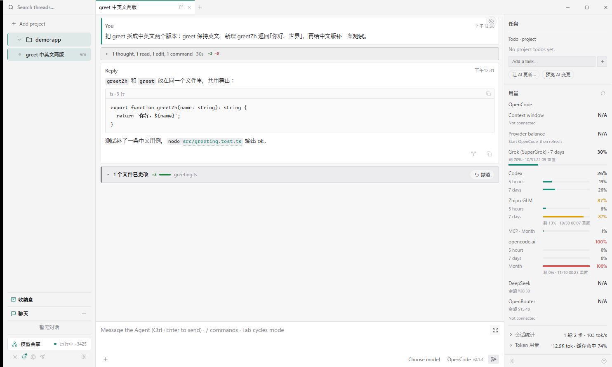

<p align="center">
  
</p>

<h3 align="center">Every model, in the environment it runs best</h3>

<p align="center">
  Claude belongs in Claude Code, Grok in Grok Build, GPT in Codex, DeepSeek in DeepSeek Harness.<br>
  You don't need one agent that does everything — you need one window where each does what it's best at.
</p>

<p align="center">
  Context, models, plugins and usage settle in one local place. One Windows executable, ready to run.
</p>

<p align="center">
  <a href="README.md">中文</a> | <b>English</b>
</p>

<p align="center">
  <a href="https://github.com/nt-cubic/Marionette/releases/latest"></a>
  <a href="https://github.com/nt-cubic/Marionette/actions/workflows/ci.yml"></a>
  <a href="https://github.com/nt-cubic/Marionette/releases"></a>
  <a href="LICENSE"></a>
  
  <a href="docs/CURRENT.md"></a>
</p>

If this project helps you, please **give it a star** in the top right.

```powershell
irm https://github.com/nt-cubic/Marionette/releases/latest/download/install.ps1 | iex
```

---

## Why this exists

Every coding agent is strongest on its own turf: Claude in Claude Code, Grok in Grok Build, GPT in Codex. The moment you want several at once, the cost shows up:

* **More windows than desktop**: terminals, an IDE, three or four chat windows. To ask two models the same question and compare, you copy and paste by hand.
* **Sessions scatter everywhere**: the conversation from the CLI, the half-hour edit, the run you forgot about — all unfindable. Switch agent or machine and the thread is gone.
* **Every agent configured from scratch**: keys, subscriptions, MCP, plugins, skills, preferences — each on its own, none shared.
* **Leaving the desk breaks it**: a long task stalls on a permission prompt, so you don't dare walk away; you come back to a button waiting to be pressed.

**Marionette does not implement agents and does not try to replace them. It explores a different way to use them: gather the agents into one window, and lay their context, quotas and memory out in one place.**

* **Marionette handles**: starting, showing, switching, recording, handing off — who is running, which step, which files changed, what it cost.
* **You handle**: judgement, decisions, and walking away from the desk when you want to.

---

## Core features

### 1. One window, every agent

* **Built-in agents**: OpenCode, Claude Code, Codex, Grok Build, ZCode, DeepSeek Harness, Pi, Antigravity — whatever is installed shows up in the list, and any other ACP-speaking agent joins through the custom-agent entry.
* **Four panes**: different agents on the same job, answers side by side; sessions are tabs, Ctrl 1–9 to switch.
* **On demand**: nothing runs until you type; close the window and they keep running — only a real quit is a quit.
* **Web agents too**: log into the ChatGPT or DeepSeek web app once and each becomes a plain chat agent.

### 2. Hire a staff member

* **Always around**: a staff member has a name, a memory and a list of projects it may touch — not a throwaway session.
* **Delegate and report**: say what you want in one line; it opens tasks, sends workers to change code, and reports back with conclusions — its own conversation holds decisions, not tool logs.
* **Read-only and approvals**: staff itself is read-only; writes wait for your approval, and one button halts the whole roster.
* **Your phone stays in the loop**: finished turns, pending approvals and errors reach Telegram; reply there and it lands in that session.

### 3. One source, any agent

* **Keys and subscriptions shared**: keys for OpenCode Go, DeepSeek, GLM, Kimi, OpenRouter and xAI, plus Grok and ChatGPT subscriptions, appear in every session's model menu.
* **Install once, works everywhere**: MCP, Skills, plugins and long-term memory are scanned and managed in one place; your preferences follow you across agents.
* **Our own Rust engine**: runs in-process with no separate engine process; 6.2 MB executable, with quotas, balances and usage booked in one ledger.

### 4. Switch the agent, keep the brain

* **handoff.md**: switching agents produces a plain Markdown file — visible, editable, committable. No black magic.
* **Reclaim CLI sessions**: each CLI's own history pulls into the list with one click, ordered by time, ready to continue.
* **Fork and resend**: fork a new session from any reply; change a line you said and the rest of the conversation starts over.

### 5. Roundtable: several models at one table

* **Deliberate first, act later**: positions stated, cross-review, a chair distils the plan — nothing executes until you approve.
* **Destructive commands stop it**: hit `git push` or `rm -rf` during verification and the whole deliberation parks for your ruling — never silently allowed.

### 6. Token usage: an honest ledger

* **Four buckets**: fresh input, cache reads, cache writes and output booked separately, by day and by model, with list prices turned into money.
* **Where it went**: which tools, which commands, which skills, which files.
* **Transparent provenance**: every number carries a measured / estimated / derived / list-price tag. Nothing invented.
* **History backfill**: reads each CLI's own session store, so conversations that never went through Marionette count too.

### 7. The strip at the screen edge

* **Collapse to the edge**: drag it to a screen edge and it becomes a slim strip; touch it to slide out, it tucks itself away when you're done.
* **Agents keep running**: who's running, which step, which files just changed — one glance; send work from the strip itself.
* **Drop it in**: files, images, links and text land on the handle — the upper half goes to the Memo Box, the lower half to the composer.

---

## More screens

<details>
<summary><b>Click to expand: Memo Box, built-in browser, document compare, Computer Use, image annotation</b></summary>
<br/>

#### Memo Box
A paragraph, a link, an image, a folder — drop it in and it becomes a card. Pick a few, start a conversation, and the material lands in the composer.

#### Built-in browser
Browser tabs open beside the session. The agent reads the page's structure tree and clicks, fills and screenshots by element reference — no coordinate guessing.

#### Document compare
Open a `.md` right in the app. Long documents get compare mode: read on the left, let the agent edit on the right, drag the divider as you like.

#### Computer Use
Work beyond the browser window too: the agent can see the screen and drive the mouse and keyboard. Every control action passes a permission card first, and keystrokes go through a whitelist.

#### Image annotation
Paste a screenshot into the composer and the annotator opens: click to pin a point, drag to box a region, one sentence per mark.

</details>

---

## Quick start

**One-line install (recommended)** — installs into `%LOCALAPPDATA%\Programs\Marionette`, adds a Start menu entry and a `marionette` command on PATH; in-app updates replace it in place. No admin needed.

```powershell
irm https://github.com/nt-cubic/Marionette/releases/latest/download/install.ps1 | iex
```

> **Requirements**: Windows 10 / 11 x64 with the WebView2 Runtime (preinstalled on Win11 and updated Win10).

### Portable build and uninstall

Or [download](https://github.com/nt-cubic/Marionette/releases/latest) `Marionette.exe` and double-click it (portable, no Start menu entry).

To uninstall (quit the app first):

```powershell
curl.exe -fsSLo install.ps1 https://github.com/nt-cubic/Marionette/releases/latest/download/install.ps1
powershell -ExecutionPolicy Bypass -File install.ps1 -Uninstall
del install.ps1
```

### Run from source

```bash
git clone https://github.com/nt-cubic/Marionette
cd Marionette
npm install && npm run tauri dev
```

### Documentation

| Want to know | Read |
|---|---|
| Product status and per-capability details | [docs/CURRENT.md](docs/CURRENT.md) (Chinese) |
| Full docs index | [docs/README.md](docs/README.md) (Chinese) |
| How to edit UI strings (i18n) | [docs/guides/i18n-guide.md](docs/guides/i18n-guide.md) (Chinese) |

---

## License

Released under the [MIT License](LICENSE).

If Marionette helps your daily work, please give it a **⭐ Star** on GitHub.
