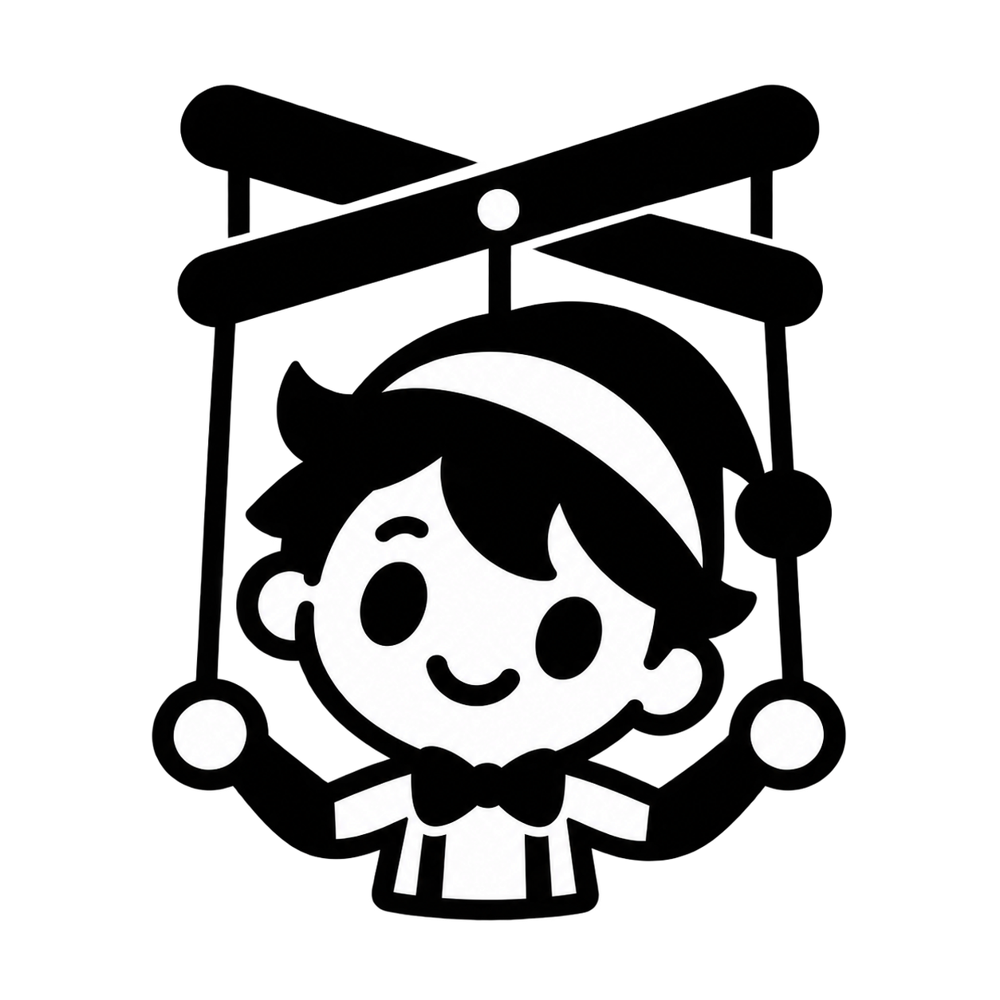

<p align="center">
  
</p>

<h1 align="center">Marionette</h1>

<p align="center">
  <strong>Agent Harness, All in One</strong><br>
  Every model, in the environment it runs best.
</p>

<p align="center">
  <a href="https://github.com/nt-cubic/Marionette/releases/latest"></a>
  <a href="https://github.com/nt-cubic/Marionette/actions/workflows/ci.yml"></a>
  <a href="https://github.com/nt-cubic/Marionette/releases"></a>
  <a href="LICENSE"></a>
  
  
</p>

<p align="center">
  <a href="README.md">简体中文</a> · <b>English</b>
</p>

<picture>
  <source media="(prefers-color-scheme: dark)" srcset="docs/screenshots/main-dark.png">
  
</picture>

---

Claude belongs in Claude Code, Grok in Grok Build, GPT in Codex, DeepSeek in DeepSeek Harness.

You don't need one agent that does everything. You need one window where each does what it's best at.

Marionette is a local multi-agent GUI shell for Windows: it starts, shows, switches and records agents — it does not implement an agent runtime. **Single-file portable build — download and double-click.**

## One window, every agent

OpenCode, Claude Code, Codex, Grok Build, ZCode, DeepSeek Harness, Pi, Hermes — one window holds them all.

The ChatGPT and DeepSeek web apps are in there too: log into the page once and they become two pure chat agents.

- **On-demand** — nothing runs until you type
- **Sessions as tabs**, up to a 4-pane split, different agents working side by side
- **Ctrl K** — one palette for navigation, new sessions, window behavior, appearance, quit (see "Ctrl K palette" below)

## Two side rails are the workbench

Find on the left, watch on the right.

- Left rail: projects, sessions, chats, the [Memo Box](#more)
- Right rail: Plan, Todo, usage, and this turn's changes

Everything sits where it belongs — no digging through the chat stream.

## Give your desktop back

Terminals and IDEs have owned the desktop long enough. Drag Marionette to a screen edge and it collapses into a slim strip leaving a sliver of a handle; slide it out when you need it, it tucks itself away when you don't.

Agents keep running beside you: who's running, which step, which files just changed — one glance. Window closed, they keep going; only a real quit is a quit.

## Ctrl K palette

Press **Ctrl K** anywhere to open the command palette. Keyboard-first, it never interrupts what you are doing:

- **Go to**: search sessions by name, arrow keys to pick, Enter to open
- **New chat**: start a new session in the default folder
- **Dock / undock**: toggle the edge strip (same as the titlebar dock button)
- **Close behavior**: choose whether the close button quits the app (default) or keeps it running in the background — window hidden, sessions and engine alive, launch again to bring it back
- **Pinned rail**: keep the side panel from retracting while docked
- **Appearance**: theme (dark / light / system) and language, one click each
- **Quit**: stop every agent and the engine, then exit

Tab shortcuts match the browser: **Ctrl T** new chat, **Ctrl W** close tab, **Ctrl Tab / Ctrl Shift Tab** cycle tabs, **Ctrl 1-9** jump to the Nth, **Ctrl Shift T** reopen the last closed one.

## Switch the agent, keep the brain

Moving from Claude to OpenCode doesn't lose the thread. Marionette generates a plain `handoff.md` — visible, editable, committable to Git. No black magic.

Chats from the CLI? One click pulls them into the list, ordered by time, ready to continue.

## One source, any agent

Keys for OpenCode Go, DeepSeek, GLM, Kimi, OpenRouter and xAI, plus Grok and ChatGPT subscriptions, all show up in every session's model menu. Configure once, not once per agent.

MCP, Skills, long-term memory — one scan, one place. The same tool works for every agent; your preferences follow you across switches.

## More

- **Memo Box** — drop things in, organize them into a conversation later
- **Delivery card** — what changed this turn, at a glance
- **Bilingual UI** — 中文 ⇄ English, one click via Ctrl K
- **Parallel subagents** — each on its own, no scroll spam
- **Telegram** — get replies on your phone, answer from it
- **Image annotation** — circle it and say what to change

## Quick start

> [Download](https://github.com/nt-cubic/Marionette/releases/latest) `Marionette.exe` and double-click. Requires the WebView2 Runtime (preinstalled on Win11 and updated Win10).

<details>
<summary>Run from source</summary>

```bash
git clone https://github.com/nt-cubic/Marionette
cd Marionette
npm install && npm run tauri dev
```

</details>

<details>
<summary>Documentation map</summary>

| Want to know | Read |
|---|---|
| Product status and per-capability details | [docs/CURRENT.md](docs/CURRENT.md) (Chinese) |
| Full docs index | [docs/README.md](docs/README.md) (Chinese) |
| How to edit UI strings (i18n) | [docs/i18n-guide.md](docs/i18n-guide.md) (Chinese) |

</details>

---

## License

[MIT](LICENSE) · © 2026 nt-cubic
