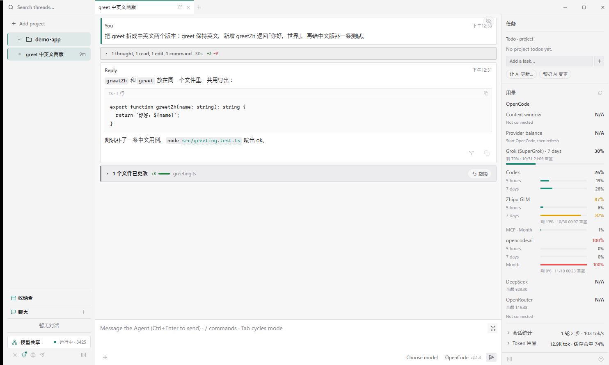

<p align="center">
  
</p>

<h1 align="center">Marionette</h1>

<h3 align="center">每个模型，都跑在它最擅长的环境里</h3>

<p align="center">
  Claude 用 Claude Code，Grok 用 Grok Build，GPT 用 Codex，DeepSeek 用 DeepSeek Harness。<br>
  你不需要一个 Agent 做所有事，只需要一个窗口让它们各司其职。
</p>

<p align="center">
  上下文、模型、插件与用量统一沉淀在本地。Windows 单文件，下载即用。
</p>

<p align="center">
  <b>中文</b> | <a href="README.en.md">English</a>
</p>

<p align="center">
  <a href="https://github.com/nt-cubic/Marionette/releases/latest"></a>
  <a href="https://github.com/nt-cubic/Marionette/releases"></a>
  <a href="LICENSE"></a>
  
  <a href="docs/CURRENT.md"></a>
</p>

如果本项目对你有帮助，请在右上角**给个 star** 吧！

```powershell
irm https://github.com/nt-cubic/Marionette/releases/latest/download/install.ps1 | iex
```

---

## 背景与设计初衷

每个 coding agent 都在自己的主场上更强：Claude 在 Claude Code 里、Grok 在 Grok Build 里、GPT 在 Codex 里。可当你想同时用几个，代价就出现了：

* **窗口越开越多**：终端、IDE、三四个聊天窗口同时开着。想把同一个问题丢给两个模型对比答案，得手动复制粘贴。
* **会话散落各处**：命令行里聊过的、改了半个小时的、跑完忘了的对话，翻不回来。换个 Agent 或换台机器，上下文就断了。
* **每个 Agent 都要重新配一遍**：key、订阅、MCP、插件、技能、偏好，各配各的，互不相通。
* **离开电脑就断了**：长任务跑到一半卡在权限确认上，人不敢走；走了回来发现它在等一个按钮。

**Marionette 不实现 Agent，也不打算替代它们。它探索的是另一种用法：把 Agent 收进一个窗口，把它们的上下文、额度和记忆摊在一处。**

* **Marionette 负责**：启动、展示、切换、记录、交接——谁在跑、跑到哪一步、改了哪些文件、花了多少钱。
* **你负责**：判断、拍板，以及在合适的时候离开电脑。

---

## 核心功能

### 1. 一个窗口，装下所有 Agent

* **内置多家 Agent**：OpenCode、Claude Code、Codex、Grok Build、ZCode、DeepSeek Harness、Pi、Antigravity——装好就在列表里；其它支持 ACP 协议的 Agent 用「自定义 Agent」随时加进来。
* **四格分屏**：不同 Agent 并排干同一件事，答案放在一起比；会话就是标签页，Ctrl 1–9 切换。
* **按需启动**：你不输入，它不运行；关掉窗口它还在跑，真正退出才叫退出。
* **网页版也在里面**：ChatGPT 与 DeepSeek 网页版登录一次，就是两个纯聊天 Agent。

<p align="center">
  
  <br/>
  <sub>两个 Agent 分屏改造同一个项目：左栏是项目与会话，右栏是本轮改动与额度</sub>
</p>

### 2. 雇一位员工

* **长期在场**：员工有自己的名字、记忆和项目授权，不是用完即弃的会话。
* **派活与汇报**：交代一句话，它自己开任务、派 worker 去改代码，跑完回来给结论——它的对话里只有决定，不刷工具日志。
* **只读与审批**：员工本身只读，写操作要你点头；一个按钮急停全部员工。
* **手机也在线**：会话跑完、等你批准、出错，通知直接推到 Telegram；回一句话就是往那个会话发消息。

### 3. 一个来源，喂给任何 Agent

* **Key 与订阅打通**：OpenCode Go、DeepSeek、GLM、Kimi、OpenRouter、xAI 的钥匙，Grok 与 ChatGPT 的订阅，都能出现在任意一个会话的模型菜单里。
* **装一次，全都生效**：MCP、Skills、插件、长期记忆扫描一次统一管理，换 Agent 时偏好跟着走。
* **自研 Rust 引擎**：进程内运行，无独立引擎进程；exe 6.2 MB，额度、余额与用量记在同一本账上。

### 4. 换人，不换脑子

* **handoff.md**：换 Agent 时生成一份普通 Markdown，看得见、改得了、能提交 Git——不靠黑魔法。
* **回收命令行会话**：各 CLI 自己的历史点一下就收进列表，按时间排在一起接着聊。
* **分叉与重发**：从任意一条回复分出新会话；改一句说过的话，后面的对话重新来。

### 5. 圆桌：几个模型同席

* **先审议，后动手**：各自陈述、互相评审，主席汇总成计划——你批准之后才执行。
* **破坏性操作停下来**：验证阶段撞上 `git push`、`rm -rf` 这类命令，整个审议暂停等你裁决，绝不静默放行。

### 6. Token 用量：一本诚实的账

* **四桶记账**：新算、缓存读、缓存写、输出分开记，按天、按模型折算成钱。
* **去向拆解**：花在哪些工具、哪些命令、哪些技能、改了哪些文件。
* **口径透明**：每个数字都带「实测 / 估算 / 推导 / 牌价」标签，不编数。
* **历史回填**：直接读各家 CLI 自己的会话库，不经过 Marionette 开的对话也算进去。

### 7. 桌面边缘的那一条

* **贴边收起**：拖到屏幕边缘就收成一条窄带，鼠标触碰滑出，用完自己退回去。
* **边上继续跑**：谁在跑、跑到哪一步、刚改了哪几个文件，扫一眼就有；想派活就在窄带里发。
* **拖进去就收下**：文件、图片、链接、文字拖到把手上，上半条进收纳盒，下半条进输入框。

---

## 界面与功能预览

<details>
<summary><b>点击展开：收纳盒、内置浏览器、文档对照、Computer Use、图片批注</b></summary>
<br/>

#### 收纳盒
一段文字、一个链接、一张图、一个文件夹——拖进来就是一张卡。多选几条开新对话，材料清单自动进输入框。

#### 内置浏览器
浏览器标签就在会话旁边。Agent 读到的是页面结构树，按元素引用点击、填表、截图，不靠猜坐标。

#### 文档对照
对话里点开 `.md` 直接在应用里读。长文档开对照模式：左边读，右边让 Agent 改，分隔条随便拖。

#### Computer Use
跨出浏览器窗口的活也能交：Agent 能看到屏幕、操作鼠标键盘。每一次控制先过授权卡，按键走白名单。

#### 图片批注
截图贴进输入框自动打开批注：点一下是标记，拖一下是框选，每个标记配一句话。

</details>

---

## 快速开始

**一行安装（推荐）** — 装进 `%LOCALAPPDATA%\Programs\Marionette`，加入开始菜单，终端里也有 `marionette` 命令；之后应用内更新会原地替换。不需要管理员权限。

```powershell
irm https://github.com/nt-cubic/Marionette/releases/latest/download/install.ps1 | iex
```

> **系统要求**：Windows 10 / 11 x64，需要 WebView2 Runtime（Win11 与更新过的 Win10 自带）。

### 便携版与卸载

也可以[下载](https://github.com/nt-cubic/Marionette/releases/latest) `Marionette.exe` 直接双击（便携版，不进开始菜单）。

卸载（先退出应用）：

```powershell
curl.exe -fsSLo install.ps1 https://github.com/nt-cubic/Marionette/releases/latest/download/install.ps1
powershell -ExecutionPolicy Bypass -File install.ps1 -Uninstall
del install.ps1
```

### 从源码运行

```bash
git clone https://github.com/nt-cubic/Marionette
cd Marionette
npm install && npm run tauri dev
```

### 更多文档

| 想了解 | 去看 |
|---|---|
| 产品现状与每项能力的细节 | [docs/CURRENT.md](docs/CURRENT.md) |
| 全部文档索引 | [docs/README.md](docs/README.md) |
| 界面文案（中英双语）怎么改 | [docs/guides/i18n-guide.md](docs/guides/i18n-guide.md) |

---

## 开源许可证

本项目基于 [MIT License](LICENSE) 协议开源。

如果 Marionette 对你的日常工作有所帮助，欢迎在 GitHub 上为本项目点亮一个 **⭐ Star**。
