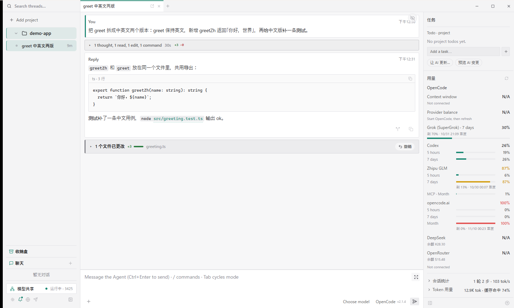

# Marionette

**你 -> Marionette -> 所有 Agents Harness**

鞋子每天在变，但人没有理由削足适履。

使用提线木偶（Marionette），让它帮你操作所有 Agents。

OpenCode、Claude Code、Grok Build、Codex、Pi、DeepSeek……把他们配进同一个壳里。

让所有 Agents 坐在一起，共享同样的知识、记忆与工具——**任意来源的模型、钥匙、订阅，也能喂给任意一个 Agent。**

你不用适应工具，让工具来适应你不断精进的做事方法。

在即将到来的时代，让 AI 成为你的部下，开始真正的运筹帷幄。



> 当前版本 **v0.5.0** · [Releases](https://github.com/nt-cubic/Marionette/releases/tag/v0.5.0)
>
> 便携版约 16 MB，跨用引擎打在 exe 里，打开即用

**现行状态说明：** [docs/CURRENT.md](docs/CURRENT.md)  
（历史策划/路线图已挪到 [docs/archive/](docs/archive/)）

---

## 为什么存在 Marionette

Agents 更新 + 定价变化 + 用量限制 = 总是需要换用 Agents。  
模型、钥匙、订阅也一样：今天走 Grok，明天走 OpenCode Go，后天把同一把 key 喂给 Claude。

Marionette 让你在同一个工具里操纵所有 Agents，也让**同一个来源**出现在每一个会话的模型菜单里。

关注你作为人，使用 AI 的能力，而不是让人来适应持续变化的 Agents。

---

## 核心能力

### 一个窗口，所有 Agent

Claude Code、OpenCode、Codex、Grok Build、DeepSeek Harness、Pi、Hermes，一个窗口全部装下。任意自定义 ACP 也能加进来。

按需启动——不输入，不运行，不占资源。一个会话绑定一个 Agent，但随时可以换人；分屏里还能让不同 Agent 并排干活。

### 两条侧栏，就是工作台

左边管「找」：项目与会话树（置顶、按最近发送排序、今天/昨天/本周/更早分组、标题搜索、状态筛选、拖拽排序、收起多余会话）、独立的聊天列表、收纳盒，以及打开文件夹、重命名、删除等右键操作。底部常驻模型共享、主题、桌面通知、代理和 Telegram。整条侧栏可以折叠；贴边时自动变成覆盖层，按钮下放到窄条底栏。

右边管「看」：当前任务的 Plan 与项目 Todo（可吸收进 Todo、让 AI 更新、预览变更）、实时用量与订阅额度、跨 Agent 记忆、插件、本轮改动文件与分支、项目上下文（MCP / Skills）、会话统计。侧栏宽度可拖，也可以整栏收起。

所有东西都在该在的位置，不用在聊天流里翻找。

### 换人，不换脑子

切换 Agent，上下文不会断。

Marionette 自动生成一个普通的 Markdown 文件，让不同的 Agent 可以根据此资料进行对话接力。

命令行里聊过的，点项目旁的刷新就能收进列表，按时间排在一起，点开接着聊。只收你添加过的目录。

### 记忆共享：一份长期记忆，所有 Agent 共用

壳是唯一同时看得见所有 Agent 的地方，所以长期记忆放在这里。

- **打开就收编**：自动扫描各家的全局指令与自动记忆——Claude 的 `CLAUDE.md` 与 `projects/*/memory/`、Codex 的 `AGENTS.md` 与 `memories/`、Grok 的 `memory/` / `memory-v2/`、OpenCode 与 ZCode 的 `AGENTS.md`。
- **逐条勾选**：启用的条目会在每个 Marionette 会话的第一条 prompt 前注入一张 `<marionette-memory>` 记忆卡（有长度上限；纯斜杠命令不消耗这次注入）。换 Agent、开新会话，都不用重新教它你的偏好。
- **从会话提炼**：把当前对话交给 DeepSeek 提炼要点，确认后存为记忆。
- **扫不到也知道为什么**：空列表会列出每个来源、探测路径与是否命中。
- 记忆统一存在 `~/.marionette/memory/memory.json`；各家原文件只读，不会被改写。

### 插件与上下文：DSH 插件，MCP / Skills 全线共享

- **插件面板**：从包名或 `github:owner/repo` 安装到 DSH Harness 的 `acp` profile，一键卸载。每个插件带兼容徽章——完全支持 / 部分功能受限 / 网页版专用 / 未知。纯改造 DSH 网页版的插件在木偶里不会生效，装之前就能看见。
- **MCP 与 Skills**：扫描本机与项目的 agent 配置，统一列在「项目上下文」。勾选后借给下一次 `session/new`——MCP 以 server 形式接入，Skills 以指针列表交接；晚启动的 MCP 服务可以原地 Reconnect，不用重开会话。
- 同一个工具，OpenCode 能用，Claude Code、Codex、Grok 也能用。

### 跨用：一个来源，喂给任何一个 Agent

打开软件就会把跨用网关拉起来，不用先去「配密钥」才能看见模型。

- **直连 key**（OpenCode Go / DeepSeek / GLM / Kimi / OpenRouter / xAI）：写进凭据，或本机已有 OpenCode 钥匙，Claude / Grok 会话里直接能选
- **订阅**（Grok、ChatGPT）以及 **Codex**：走内置翻译引擎。Codex 把内建模型名接到你选的那一个上
- **DSH / Pi**：spawn 时原生写入托管路由，模型直接出现在它们自己的目录里
- **模型菜单**：按来源分组，按账号去重，可隐藏 provider / 模型、调整顺序，保存在 `~/.marionette/model-library.json`

左下角互联图标 = 网关状态 / 一键启动 / 停止。密钥管理在浮层底部。闲置会自己停，再点就会醒；引擎本身也可以单独更新。

### 轻，还能贴边待命

打开就工作，关闭就消失。单文件免安装，跨用引擎打在 exe 里。

把窗口拖到屏幕左右边缘会自动吸附，只留 6px 淡轨与一根把手；鼠标碰到就滑出，也能把文件直接拖到把手上展开。关闭主窗 = 贴边收起，Agent、会话和 Telegram 桥继续在后台跑，真正退出走窄条 ⋯ 菜单。贴边时可以让窄条常驻（不再自动收回），也能把宽度从 320 拖到 560。

---

## 还有更多

- **对话轨迹** —— 思考与工具按运行段折叠成一张 tally 卡；运行时上方实时泳道时间图 + 最新思考预览，瞬时工具也画得出时间条
- **再次进入对话** —— 回合结束后 Agent 自己续跑（后台命令回来），会话自动回到运行中，Working 条与轨迹图回来；静默后自动收尾
- **交付卡** —— 每轮真实内容差异（私有 git index 快照），文件列表、增删行数与 diff 一致，别的对话的改动不会串进来
- **消息卡片 / 工具卡片** —— 所有 Agent 输出统一渲染，思考过程折叠；读过的图片直接显示，编辑类工具给出带行号 diff，可逐行批注
- **对话目录 / 图片批注 / 对话标记** —— 目录跳转；点选图片区域直说要改哪里；选中消息加批注，下次打开还在，可带入 Composer 引用
- **多窗口 / 分屏** —— 拖出标签用幽灵预览开独立窗；主窗最多四格（1|1|1、1|2、2×2），拖回主窗并入，重启恢复分屏
- **收纳盒** —— 拖文件/文件夹进贴边窄条或侧栏入口即收，内容哈希去重；Ctrl+V 收文字与链接；可多选开新对话（材料预填）或整理成文档
- **Telegram 远程** —— 手机收完成/等待/出错通知，权限、ask、plan 内联按钮远程解答，回复即发送，`/status` 看总控面板
- **Ctrl K** —— 跳任意对话/项目、新建对话/聊天、重开刚关的标签、切主题、贴边/解除、退出
- **每一笔消耗，都摆在桌上** —— 余额、额度、速率限制、订阅配额，右侧栏实时刷新
- **持久化** —— 所有会话存 JSONL，全文可搜索，重开不丢；命令行历史刷新后也落在同一套列表里
- **Git 感知** —— 项目文件变化自动检测，一眼看到改了什么；可让 AI 写 commit 并推送
- **@ 委派 / 智能回复** —— 消息里 @ 另一个 Agent 派发任务并自动交接上下文；文件刚拖进来、AI 给了选项、上轮报错时出现一键接话气泡
- **Tasks / Chat / 置顶 / 资源管理器** —— 项目级 Todo 换 Agent 不丢；独立聊天不绑定项目；项目与会话都能置顶；侧栏直接打开项目文件夹
- **主题 / 代理 / 桌面通知** —— 多套明暗主题、单一代理出口、任务完成与等待提醒

---

## 快速上手

```bash
git clone https://github.com/nt-cubic/Marionette
cd Marionette
npm install && npm run tauri dev
```

添加项目 → 选择 Agent → 开始对话。

> 目前只支持 Windows（需要 WebView2 Runtime，Win11 与更新过的 Win10 自带）。
> Windows 上也可以直接双击根目录的 `start-marionette.bat`：它会先检查 Node / Rust / MSVC，缺了会引导你安装。

### 直接下载

[Releases](https://github.com/nt-cubic/Marionette/releases/latest) 里的 `Marionette.exe`，双击即可。跨用引擎已经打在里面，打开就会拉起来。

```bash
gh release download --clobber -p "Marionette.exe"
```

---

## 仓库结构

```
Marionette/
├─ start-marionette.bat   # 唯一双击入口：起开发版
├─ src/                   # 前端（React）：app / components / lib / styles
├─ src-tauri/             # 后端（Rust + Tauri 2）
├─ third_party/magpie     # 跨用引擎源码（yetone/magpie，内置引擎版编进 exe）
├─ docs/                  # 文档：CURRENT.md 是现行契约，索引见 docs/README.md
├─ scripts/               # 代码验证脚本（transcript / delivery / re-entry 等）
└─ tools/                 # Windows 启动、构建、发布脚本 + 本地二进制（upx）
```

约定：根目录只放工具链需要的文件（`package.json`、`vite.config.ts`、`index.html` 等）和那一个启动入口，
其余按用途进 `docs/`、`scripts/`、`tools/`。运行期产物 `.marionette/`、`dist/`、`release/`、`node_modules/` 都已忽略。

便携构建：`tools\build-portable.bat` → `release\<版本号>\Marionette.exe`（按版本分目录）。发布：`tools\publish-release.bat`。

---

## License

MIT，全文见 [LICENSE](LICENSE)。

---

## 使用说明

1. **启动**：双击 `Marionette.exe`（或开发版 `start-marionette.bat`），左侧栏新建项目并选择 Agent。
2. **对话**：在底部输入框发消息；右侧栏看 Plan、用量与本轮改动，点模型芯片可随时换模型/换 Agent。
3. **日常操作**：拖窗口到屏幕左右边缘贴边待命；`Ctrl K` 跳转会话、新建对话、切主题；拖文件进侧栏收纳盒暂存材料。
4. **退出**：点关闭 = 贴边后台继续跑；真正退出走窄条 ⋯ 菜单。
