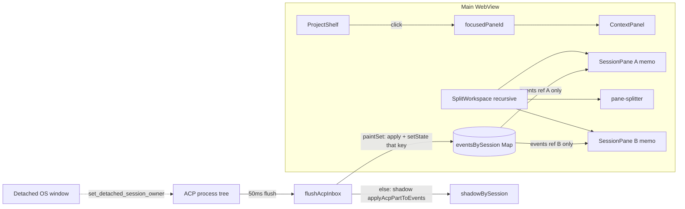

# 对话区内分屏 / 停靠（设计稿）

> 状态：**PR1–PR6 已进树**（模型 + 渲染预算 + 分屏 UI + 冷启动恢复 + 撕窗拖回落点 + 上下拆 / 最多 4 格 / 「在右侧打开」，2026-10-18）。
> 现行行为已写入 [`CURRENT.md`](./CURRENT.md)；本文件仍是设计合同，全部稳定后再挪进 `archive/`。

## 一句话

在**同一个** Marionette 窗口的对话区里，把会话标签拖到左/右边缘，松手后并排显示 2 路（后续最多 4 路）对话——每格自己的标签栏、转写、输入框；不新开 OS 窗口，不嵌套 WebView。

## 场景

- 32 寸屏全屏一个 Marionette：左边 Grok 改代码、右边 OpenCode 查资料，不用把眼睛挪到第二块显示器。
- 第二块显示器仍然走**现有**撕窗（`detachedWindow.ts`）+ Windows 吸附；分屏不替代撕窗，两者互斥（同一会话不能同时在格子里和撕窗里）。
- 拖标签、出预览、松手才落地——误拖可以拖回去或按 Esc，不会中途拆开工作区。

## 明确不做

- 不把 OS / WebView 子窗口嵌进应用当格子（Windows 上拆 WebView 会崩，2026-10-16 渲染假死也是多路流同时进同一 WebView 的教训）。
- 不做 Unity/Unreal 级任意嵌套停靠、浮出面板、把侧栏 / 检查器 / 工具条也停靠。
- 不做 IDE、不做云同步、不改 ACP runtime。
- 同一会话禁止同时出现在两个格子，或格子 + 撕窗。
- detached 窗本身不分屏（继续单会话，`detachedMode`）。
- v1 不做格子内标签拖拽排序（拖出条带才进入手势；落回源条带 = 取消）。

## Key Decisions

| 决定 | 选择 | 理由 |
|---|---|---|
| 实现形态 | 同一 WebView 里的 React 格子，不是子 WebView / 新 OS 窗 | 产品底线是轻壳；Windows 上拆 WebView 会崩（`detachedWindow.ts` 关窗只 hide）；假死要靠预算而不是再开进程 |
| 手势 | 拖**会话标签**，幽灵芯片跟指针，**pointerup 才 commit** | 与现有撕窗手势同一套肌肉记忆（`SessionTabs` 已有 ghost）；预览可取消 |
| 焦点 | 每格有 active tab；整窗有一个 `focusedPaneId`；快捷键 / 侧栏 / 检查器跟焦点格 | Esc×2 打焦点会话。**格子里的发送/暂停/切 agent 绑该格 `activeTabId`**，不绑焦点 |
| 上限 | 最多 **4** 叶格（左右 / 上下 / 1\|2 / 2×2） | 数据模型按 4 叶二叉树一次设计；**PR3** 递归渲染，禁止写死两列。**PR6** 打开 `allowHorizontal` 与 `maxLeaves=MAX_PANES` |
| 持久化 | `UiRestoreSnapshot.splitLayout`，缺字段 = 今日单格 | 冷启动要回到分屏；`deserialize(..., { maxLeaves })` 让 v1 读到 4 叶快照时压成标签 |
| 渲染隔离 | `Map<sessionId, SessionEvent[]>` + `memo(SessionPane)`；`paintSet` = 各叶 active ∪ 其未完成 `@-delegate` 子会话；**隐藏标签走廉价路径** | 假死根因是共享 `liveEvents` 上 `setLiveEvents` 让所有挂载树 reconcile。过滤同一数组给两格 = 再冻一次 |
| 廉价路径 | 抽出今日 apply+coalesce+turnStart **同一 wrapper** 打 shadow；JSONL timer 由 shadow 变更武装 | 禁止第二根 `liveEvents` 数组；隐藏流不 publish 也必须落盘 |
| 去重 | 会话 id 在所有格子 ∪ 可见撕窗里全局唯一 | `shouldHandleAcpSession` 按窗口所有权分流；格子层再加位置不变量 |
| 抽出 | 纯函数 `src/lib/splitWorkspace.ts`；预算 `src/lib/acpRenderBudget.ts`；UI `SplitWorkspace` / `SessionPane` | `App.tsx` ~6783 行且与其它未提交工作混 hunk。预算 PR 与分屏 UI PR **拆开**，因 UI 不可独立回滚 |
| 焦点跟随被拖会话 | split / activate / insert 之后 `focusedPaneId` = 该会话所在叶 | 松手后输入框跟过去，不必再点一次 |

## 现状锚点（实现时对照，勿凭记忆改行号）

现行架构是 **一个可见会话**。对话区不是「多实例」，而是 App 根上的单数状态滤出一条转写。

### 布局壳

```
workspace-grid（三列：侧栏 | 中区 | 检查器；两行：标题栏 + 内容）
  left-rail / ProjectShelf
  workspace-titlebar          ← SessionTabs + 拖区 + WindowControls（跨中区+检查器）
  center-workspace            ← 一块 SessionView + 一块 composer-slot
  ContextPanel
```

| 符号 | 位置 | 现行行为 |
|---|---|---|
| `.workspace-grid` | `src/styles/app.css:14` | `grid-template-columns: left minmax(0,1fr) right`；行 1 = 34px 标题栏 |
| `.workspace-titlebar` | `app.css:48` | `grid-column: 2 / -1`，标签条横跨中区+检查器 |
| `.center-workspace` | `app.css:176` | 两行：转写 `minmax(0,1fr)` + composer `auto` |
| `.panel-resizer` | `app.css:66` | 侧栏/检查器拖宽；`resizingSide` 在拖动中只改 CSS 变量，mouseup 才 setState（`App.tsx` ~3291） |
| `.composer-slot` | `app.css:5583` | 输入框挂在中区底部，与转写是**兄弟**，不是 SessionView 内部 |
| `.session-view` | `app.css:1926` | 只画转写，不含标签、不含输入框 |
| `SessionTabs` | `SessionView.tsx:144` | 从 SessionView 拆出，由 App 画在标题栏（`App.tsx:6254`） |
| `SessionView` | `SessionView.tsx:512`，挂载于 `App.tsx:6321` | **仍要求** `onTabSelect` / `onTabClose` / `onNewTab`（`:86–88`）但**不再画标签**；PR3 删这些 props |
| `Composer` | `Composer.tsx`，`App.tsx:6488` | `key={sessionId:agentId}` 切会话会整棵重挂。`onSend` / `onInterrupt` / `onWarmAgent` / `onEnsureAgentReady` / `onAgentChange` **都不带 sessionId**（`:136–174`） |

### 标签拖拽 / 撕窗（将要扩展，不是重写）

| 符号 | 位置 | 现行行为 |
|---|---|---|
| `TAB_DRAG_ARM_PX = 10` | `SessionView.tsx:113` | 移动超过 10px 才武装 |
| `TAB_DETACH_SLOP_PX = 28` | `SessionView.tsx:112` | 条带外 28px 才算离开 |
| `pointerOutsideTabStrip` | `SessionView.tsx:124` | 离开条带 **或** 离开 OS 窗客户区。中区内拖已经 `outside===true`，ghost 会出（`:301–304`）——单格拆分靠这条 |
| `tab-tear-ghost` | `SessionView.tsx:490` + `app.css:2096` | 幽灵芯片；**WebView 只在 mouse-up 创建** |
| `is-tab-detaching` | `app.css:2087` | 拖时全局 `grabbing` |
| `MERGE_HIGHLIGHT_EVENT` | `detachedWindow.ts:48` | 撕窗拖回主窗时点亮主窗标签条 |
| `onTabPopOut` / `handleTabPopOut` | `SessionView.tsx:171` / `App.tsx:3958` | 有 ghost 的 pointerup **无条件**撕窗（`:334–341`） |
| `setDetachedSessionOwner` | `detachedWindow.ts:66` → Rust `commands.rs:1043` | 一路 ACP 流只派给一个窗口 |
| `shouldHandleAcpSession` / `acpUiRootSessionId` | `detachedWindow.ts:79–105` | 子会话按 **parent** 归属窗口。`ownsAcpSession`（`App.tsx:717`）包一层 |
| `cursorLogical` | `detachedWindow.ts:138` | `cursorPosition() / scaleFactor`，逻辑像素；**不是**主窗客户区坐标 |
| 关窗 | `detachedWindow.ts` 文件头注释 | **hide 不 destroy**（tao / WebView teardown 会崩） |

今日松手语义：主窗标签拖出条带 = **撕 OS 窗**。分屏要把「仍在主窗客户区内、落在中区边缘」从这条路径里拆出来。

### App 上绑死「当前那一个」的状态

`src/app/App.tsx`（`export function App` 于 :355，文件止于 :6783）。单数状态（实现时按符号搜，行号会漂）：

| 符号 | 约行 | 今日含义 |
|---|---|---|
| `currentSessionId` | 360 | 焦点会话；侧栏高亮、发送、中断、恢复快照都读它 |
| `openSessionIds` | 362 | 标题栏标签顺序 |
| `sessionCapabilities` | 418 | **一份** caps；`openSession`（:3616）切会话会 `null` 掉 |
| `liveEvents` | 419 | 全会话共享数组；`handleAcpEvent` 里 `applyAcpPartToEvents`（`acpTranscript.ts:1220`，调用 `App.tsx:1750`）后 `setLiveEvents`；`currentEvents`（:3401）`filter` 给唯一 `SessionView` |
| `activeModelId` | 432 | Composer 回调，给检查器 usage |
| `detachedOwnedIdsRef` | 475 | 主窗认为已被撕窗拿走的 session |
| `streamSuppressedRef` | 470 | 中断后丢掉迟到的 thought/message chunk |
| `quotePins` | 633 | 一份；`useEffect` 在 `currentSessionId` 变化时清空（:2816） |
| `composerPrefill` | 631 | 一份 token 预填 |
| `askPrompt` | 渲染 :6387 | 门控 `askPrompt.sessionId === displaySession.id` |
| `planApproval` | 渲染 :6396 | 同上，且 Ask 优先 |
| `permissionPrompt` | 渲染 :6595 | 门控 `permissionPrompt.sessionId === currentSessionId`（**不是** `displaySession.id`） |
| `displaySession` / `currentEvents` / `currentAgent` | 3377–3401 | 从 `currentSessionId` 派生的「正在画的那一个」 |
| `handleSend` | 5414 | 闭包读 `currentSessionId`（:5420）；`quotePins` / `displaySession` 也是焦点的 |
| `performSend` | 5543 | `sessionCapabilities`、`displaySession` prefs、`currentAgent`、`activeModelId` |
| `warmActiveAcp` | 3854 | `currentSessionIdRef`；Composer `:6536` `onWarmAgent={warmActiveAcp}` |
| `onEnsureAgentReady` | :6537 | `ensureAcpReady(currentSessionId)` |
| `handleInterrupt` | 4852 | 只取消 `currentSessionId`；Composer `:6529` 与 SessionView `:6357` 共用 |
| `handleAgentChange` | 4387 | `currentSessionId`；Composer `:6528` |
| `handleTabPopOut` | 3958 | 从 `openSessionIds` 摘掉；**最后一枚也建新 Chat**（:3986），即使本意只是撕这一条 |
| `closeSessionTab` | 3897 | 关最后一 tab 立即建新 Chat（:3904） |
| `flushAcpInbox` / `ACP_EVENT_FLUSH_MS = 50` | 2305–2308 | 2026-10-16 假死修复：监听只入队，50ms 一批；owns 守卫 :2321 |
| `touchActivity` | 842 | 每会话最多 1 次/秒往根 setState |
| `LAYOUT_STORAGE_KEY` | 150 | 只记左右栏宽度，与分屏无关 |
| `saveUiRestore` | `uiRestore.ts` | `{ sessionId, projectId, openSessionIds, splitLayout? }`；旧版忽略多余字段 |
| `loadSessionTranscript` | :2732，effect :2810 | **只**在 `currentSessionId` 变化时加载 |
| `parentIdOfSession` | :711 | 给 `shouldHandleAcpSession` 走 `@-delegate` 父 id |

### 持久化 / 内存

| 符号 | 位置 | 今日含义 |
|---|---|---|
| `UiRestoreSnapshot` | `src/lib/uiRestore.ts` | `sessionId` + `projectId` + `openSessionIds` + `updatedAt` + 可选 `splitLayout` |
| `pickRestoredSession` | `uiRestore.ts` | 撕窗 URL > 树焦点；`deserialize(..., { maxLeaves: MAX_PANES, excludeSessionIds })` 扣可见撕窗 |
| `collectHotSessionIds` | `src/lib/memoryHygiene.ts:18` | `currentSessionId ∪ openSessionIds ∪ 活 ACP ∪ 未完成 @-delegate`（热 = 不从内存丢掉，**不是** 50ms 发布） |
| `applyAcpPartToEvents` | `src/lib/acpTranscript.ts:1220` | 按 session 的轨尾追加/合并；`coalesceAdjacentThoughts` 在 `App.tsx:1777` |

### 渲染预算（已落地 / 未落地）

已落地（`App.tsx` ~2300 注释 + `touchActivity` :838）：acp-event 50ms 批处理；`touchActivity` 每会话 1/s。

未落地（假死笔记后续项）：

1. **非 paintSet 会话走廉价路径**（隐藏标签 + 根本不在树里的会话）。这是 10-16 的触发条件（两路流、只画一路）。
2. 格子隔离：A 的 chunk 不得换 B 的 `events` 引用。
3. Rust 侧对后台 thought 丢弃/降频——**不在本功能范围**。

`ViewportMount`（`src/components/ViewportMount.tsx`）是转写**行**级近视口挂载，不是会话级。长转写已有 `useVirtualWindow`（`SessionView.tsx:1313`，≥48 张卡片才虚拟化）。

## 目标与非目标

**目标**

- 主窗对话区可 2 格并排（v1），数据模型支持最多 4 叶（含后续 2×2）。
- 拖标签 → 预览 → 松手拆/合/并入；拖出 OS 窗仍撕窗。
- 焦点格驱动侧栏、检查器、Esc×2；**格子内按钮绑该格会话**。
- 重启恢复分屏。
- 2–4 路同时流式时 UI 仍可点暂停/关闭（隔离 + 廉价路径）。

**非目标**（见「明确不做」）。v1 不改 Rust ACP 派发（仍按窗口所有权，不按格子）。

## 提议设计

### 总览

把「一份 `openSessionIds` + 一份 `currentSessionId`」换成一棵最多 4 叶的二叉树。每个叶是一格：自己的 tab 列表 + active tab。

转写存储从「一根共享 `liveEvents` 数组」改成 **`Map<sessionId, SessionEvent[]>`**。App 根仍跑 ACP flush；格子只订阅**自己**那根轨的引用。

```
                        ┌──────────── 同一个 WebView（主窗） ────────────┐
 ProjectShelf           │  SplitWorkspace（递归按 axis flex）              │
  (全局)                │   ┌─ SessionPane (memo) ─┐  ║  ┌─ SessionPane ─┐ │
  高亮 = 焦点格会话      │   │ SessionTabs           │  ║  │ …             │ │
                        │   │ SessionView (active)  │  ║  │ events 引用独立│ │
                        │   │ Ask/Plan（该格会话）   │  ║  └──────────────┘ │
                        │   │ Composer（回调 bind）  │  ║   pane-splitter    │
                        │   └──────────────────────┘                       │
                        └──────────────────────────────────────────────────┘
 ContextPanel 跟随 focusedPaneId 的 activeTab
 PermissionDialog 窗级 modal：一到就画，同时 fire focusSession（不等焦完）
 ACP 后端不变；ownsAcpSession 仍按「主窗 vs 撕窗」
```



### 数据模型

新建 `src/lib/splitWorkspace.ts`（纯函数，禁止依赖 React / Tauri）。

```ts
export const MAX_PANES = 4;
export const MAX_PANES_V1 = 2;         // v1 UI 硬顶；deserialize 也吃这个
export const EDGE_FRACTION = 0.25;
export const MIN_PANE_WIDTH_PX = 280;
export const MIN_PANE_HEIGHT_PX = 220;
export const MIN_SPLIT_RATIO = 0.2;
export const MAX_SPLIT_RATIO = 0.8;
export const DEFAULT_SPLIT_RATIO = 0.5;

export type SplitAxis = "vertical" | "horizontal";
// 树语义：vertical = 左|右（a 左 b 右）；horizontal = 上|下（a 上 b 下）
// CSS：vertical 枝 `flex-direction: row`；horizontal 枝 `flex-direction: column`
// （与 CSS 口语「vertical flex」相反，注释必须写在 class 旁）

export type PaneLeaf = {
  type: "leaf";
  id: string;          // "pane-N"
  tabIds: string[];
  activeTabId: string; // 空工作区时为 ""
};

export type SplitBranch = {
  type: "split";
  id: string;          // "split-N"；与叶同一套 nextId，反序列化从树求 max+1
  axis: SplitAxis;
  ratio: number;       // a 占父节点比例，clamp [0.2, 0.8]
  a: SplitNode;
  b: SplitNode;
};

export type SplitNode = PaneLeaf | SplitBranch;

export type SplitWorkspaceState = {
  root: SplitNode;
  focusedPaneId: string;
};

export type SplitLayoutV1 = {
  version: 1;
  root: SplitNode;
  focusedPaneId: string;
};

export type SplitMutation = {
  state: SplitWorkspaceState;
  /** true → App 必须先 createChat 再 addTab；禁止把 0 叶树交给渲染 */
  needPlaceholderChat: boolean;
};
```

**不变量**（`assertInvariants(state)`；`normalize` 每次 reduce 后跑）：

1. 叶数 1…调用方传入的 `maxLeaves`（默认 `MAX_PANES`）。
2. **空工作区例外：** 允许「恰好一叶、`tabIds=[]`、`activeTabId=""`」当且仅当整棵树会话数为 0。其它空叶必须 collapse。有会话却空叶 = bug。
3. 任一 `sessionId` 在整棵树里最多出现一次。
4. 非空叶：`activeTabId ∈ tabIds`；`focusedPaneId` 指向存在的叶（空工作区时指向那唯一空叶）。
5. 只剩一叶时 `root` 就是那叶（不再包 dummy split）。
6. `ratio ∈ [MIN_SPLIT_RATIO, MAX_SPLIT_RATIO]`。
7. 所有叶 id、枝 id 在树内唯一。

**id：** `nextId(state, "pane" | "split")` **只从当前树已有 id 求 max+1**，禁止模块级 counter（HMR / 热重载会漂）。反序列化后新拆分也走 `nextId`。

**从今日扁平状态迁移：**

```ts
export function migrateFromFlat(
  openSessionIds: string[],
  currentSessionId: string,
): SplitWorkspaceState {
  const tabs = openSessionIds.filter(Boolean);
  const active = tabs.includes(currentSessionId) ? currentSessionId : (tabs[0] ?? "");
  if (!active) {
    return { root: { type: "leaf", id: "pane-1", tabIds: [], activeTabId: "" }, focusedPaneId: "pane-1" };
  }
  const tabIds = tabs.includes(active) ? tabs : [active, ...tabs];
  return {
    root: { type: "leaf", id: "pane-1", tabIds, activeTabId: active },
    focusedPaneId: "pane-1",
  };
}
```

**派生（树为唯一源）：**

| 派生 | 算法 |
|---|---|
| `openSessionIds` | 先序遍历所有叶 `tabIds` 拼接 |
| `focusedSessionId` / 今日的 `currentSessionId` | `findPane(focusedPaneId).activeTabId`（空工作区为 `""`） |
| `visibleSessionIds` | 各**非空**叶的 `activeTabId` |
| `paneOfSession(id)` | 含该 id 的叶；没有则 `null` |

### Reducer（PR1 合同，审查以这些例子为准）

函数式 API，不强制 `dispatchSplit` union。App 直接调这些函数后 `setSplitState`。**焦点跟随被移动的会话。**

摘 tab 后源叶的新 `activeTabId`：若摘的不是 active，active 不变；若是，取原列表里它右边那枚，没有则左边那枚。

```ts
/** 把 sessionId 从源叶搬走（必 move，禁止 copy），在 target 叶沿 edge 拆出新叶。 */
export function splitPane(
  state: SplitWorkspaceState,
  targetPaneId: string,
  edge: DropEdge,
  sessionId: string,
  opts?: { maxLeaves?: number },
): SplitWorkspaceState;

/** activate = 成为目标叶 active tab（append）；insert-tab = 插入 index。源叶摘走。 */
export function moveTab(
  state: SplitWorkspaceState,
  sessionId: string,
  target: { kind: "activate"; paneId: string } | { kind: "insert-tab"; paneId: string; index: number },
): SplitWorkspaceState;

export function closeTab(state: SplitWorkspaceState, sessionId: string): SplitMutation;
export function popOutTab(state: SplitWorkspaceState, sessionId: string): SplitMutation; // 树变化与 closeTab 同形；**App 只在 openDetachedSessionWindow 成功后才调**
export function collapseEmpty(state: SplitWorkspaceState): SplitWorkspaceState;
export function focusPane(state: SplitWorkspaceState, paneId: string): SplitWorkspaceState;
export function activateTab(state: SplitWorkspaceState, paneId: string, sessionId: string): SplitWorkspaceState;
export function addTabToPane(state: SplitWorkspaceState, paneId: string, sessionId: string, index?: number): SplitWorkspaceState;
export function focusSession(state: SplitWorkspaceState, sessionId: string): SplitWorkspaceState; // 找到叶则 activate+focus；没有则插入焦点格
export function resizeSplit(state: SplitWorkspaceState, splitId: string, ratio: number): SplitWorkspaceState;

export function serialize(state: SplitWorkspaceState): SplitLayoutV1;
export function deserialize(
  raw: unknown,
  knownSessionIds: ReadonlySet<string>,
  opts?: { maxLeaves?: number; excludeSessionIds?: ReadonlySet<string> },
): SplitWorkspaceState;

export function nextId(state: SplitWorkspaceState, kind: "pane" | "split"): string;
export function assertInvariants(state: SplitWorkspaceState, maxLeaves?: number): void;
```

`splitPane` 规则：

- `sessionId` 必须已在某叶（通常是源）。从源 **move** 走，不复制。
- `edge` ∈ {left, top} → 新叶是枝的 `a`，原 target 叶是 `b`；{right, bottom} → 新叶是 `b`，原叶是 `a`。
- 新枝 `ratio = DEFAULT_SPLIT_RATIO`，`axis` = left/right → `vertical`，top/bottom → `horizontal`。
- `leafCount >= (opts.maxLeaves ?? MAX_PANES)` → **不拆**，等价 `moveTab(..., { kind:"activate", paneId: targetPaneId })`。
- 源叶因此变空 → `collapseEmpty`（若 target 就是源且这是最后一枚，调用方不该走到这里，见 self-split）。
- `focusedPaneId` = 新叶（会话跟手走）。

`deserialize`：丢掉不在 `knownSessionIds` 的 tab；再丢掉 `excludeSessionIds`（活着的撕窗 id）；collapse 空叶；clamp ratio；若叶数 > `maxLeaves`（v1 传 `MAX_PANES_V1`），把多出来的叶的 `tabIds` **按先序并进留下的最后一叶**（不丢会话），压到 `maxLeaves`。

#### 例子

**1. 单叶两标签，B 拖到右缘拆开**

```
before:  leaf pane-1 tabs=[A,B] active=A  focused=pane-1
splitPane(s, "pane-1", "right", "B")
after:   split split-1 axis=vertical ratio=0.5
           a: pane-1 [A] active=A
           b: pane-2 [B] active=B
         focused=pane-2
```

**2. 已两格，把 B 放到右格中央（activate）**

```
before:  split
           pane-1 [A,B] active=A
           pane-2 [C]   active=C
         focused=pane-1
moveTab(s, "B", { kind:"activate", paneId:"pane-2" })
after:   split
           pane-1 [A]     active=A
           pane-2 [C,B]   active=B
         focused=pane-2
```

**3. 关掉一叶的最后一枚（另一叶还在）**

```
before:  split pane-1 [A] / pane-2 [B]  focused=pane-1
closeTab(s, "A")
after:   root = pane-2 [B] active=B  focused=pane-2
         needPlaceholderChat=false
```

行为变化（相对今日 `closeSessionTab` / `handleTabPopOut`）：今日**任何**条带关到 0 都会立刻建新 Chat（`App.tsx:3904`、`:3986`）。分屏后只在**整棵树**没会话时才建。撕出「这一条带最后一枚」而其它格还有 tab，不再刷出一个空 Chat。

**4. 关掉最后一叶的最后一枚**

```
before:  pane-1 [A]
closeTab(s, "A")
after:   pane-1 [] active=""  focused=pane-1
         needPlaceholderChat=true
```

App：`if (result.needPlaceholderChat) { const chat = await handleCreateChatSession(); setSplit(addTabToPane(result.state, result.state.focusedPaneId, chat.id)); }`。渲染路径**从不**看到 0 叶，也不闪一帧空 Composer。

**5. max-panes 降级（v1 maxLeaves=2 时第三次 split）**

```
before:  已两叶 pane-1 [A] / pane-2 [B,C] ，拖 C 到 pane-1 的右缘
hitTest → activate pane-1（芯片「已达 2 格，放入此格」）
moveTab(s, "C", { kind:"activate", paneId:"pane-1" })
after:   pane-1 [A,C] active=C / pane-2 [B]  focused=pane-1
```

`splitPane` 自身若被误调也必须同样降级，测试覆盖。

### Focus 模型

**谁是焦点会话：** `focusedSessionId = leaf(focusedPaneId).activeTabId`。

**接线铁律（PR3 必做，见 Issue 2）：** 凡是会改某个会话的 Composer / SessionView 回调，在 `SessionPane` 用该叶 **`activeTabId` 绑死**。App 只提供带 `sessionId` 的内核：`handleSend(sessionId, …)` / `cancelLiveTurn(sessionId)` / `ensureAcpReady(sessionId)` / `warmAcp(sessionId)` / `handleAgentChange(sessionId, agentId)`。Composer 的 `onInterrupt` / `onWarmAgent` / `onEnsureAgentReady` / `onAgentChange` 仍然无 id——**pane 闭包补上**。不要把 `handleSend` 函数体复制进 SessionPane。

| 输入 | 效果 |
|---|---|
| 点击某格（转写、标签条、Composer、格子空白） | `focusedPaneId = 该叶`；不改该叶 active tab |
| 点击某格的一个标签 | 该叶 `activeTabId = 该会话` + 焦点切到该叶 |
| 侧栏点击会话 | 已在某格：focus+activate，不复制。可见撕窗：`WebviewWindow.setFocus`，主窗不插入。否则插入焦点格 |
| Composer `focus` | `onFocusCapture` → 焦点跟到该格 |
| Composer 发送 / ■ 暂停 / 切 agent / warm / ensureReady / 空框激活 | **该格 `activeTabId`**，即使焦点在隔壁 |
| Esc×2 中断 | **焦点会话**（键盘没有「点在哪格」；拖标签时第一下 Esc 先取消拖，见下，不计入 Esc×2） |
| `permission/prompt` | **产品变化：** 当事会话若在某叶，立刻 `focusSession`（必要时切该叶 active）。窗级 PermissionDialog **只要 `permissionPrompt != null` 就画**，不要等焦点 setState 完成（避免一帧/失败插入导致 120s 内看不见）。仅在撕窗：不抢主窗。不在任何格：插入焦点格 |
| `question/prompt` / `plan/approval` | **同一套** activate+focus（隐藏标签上的 Ask 否则没人看见）。卡片仍画在当事格 composer-slot，不是窗级 modal |
| Ctrl/Cmd+1…9 | 焦点格第 n 个标签 |
| Ctrl/Cmd+Shift+T | 插回焦点格 |
| 新标签 `+` / 侧栏「新对话」 | 焦点格 |
| 从回复分叉 | 新 tab 插在**源会话所在格**，并 focus 该格 |
| 检查器 | 焦点会话（PR4 才把 ContextPanel 从「派生 currentSessionId」明确绑到 focused；PR3 派生已经让它大致对） |
| `doneUnreadIds` | 非焦点会话回合结束仍打点。「看过」= 所在叶是焦点且它是 active |

焦点格视觉：`.session-pane.is-focused` inset 1px accent。不要外发光。

`currentProjectId`：跟随焦点会话的 `projectId`。

今日「后台会话的权限框要你切过去才看见」（`:6595`）。分屏后 permission/ask/plan **会抢格焦点**。写进 CURRENT 时必须点明。

### 每格 vs 全局：App.tsx 状态表

| 状态 / 处理器 | 分类 | 分屏后 |
|---|---|---|
| `availableProjects` / `availableAgents` / `availableSessions` | 全局 | 不变 |
| `currentProjectId` | 焦点跟随 | 跟 `focusedSession.projectId` |
| `currentSessionId` | **焦点会话** | 派生自树；写入走 `focusSession` |
| `openSessionIds` | 派生 | 所有叶 `tabIds` 先序 |
| `splitState` | **新，源** | 唯一布局源 |
| `liveEvents` / `liveEventsRef` / `setLiveEvents` | **PR2 删除，禁止第二根轨** | 唯一存储：`eventsBySession` Map + 每会话 shadow（paintSet 内两者同一引用）。唯一写口：`updateSessionEvents(sessionId, fn)`。今日 ~70 处 `setLiveEvents` / `liveEventsRef.current.filter(e => e.sessionId === sid)` 全改走 helper。`SessionView`/`Composer` 拿 `map.get(sid) ?? EMPTY_EVENTS`，**禁止**再 concat 整图 |
| `sessionUsageById` / `slashCommandsById` / `planBySessionId` | 每会话 | 不变 |
| `lastActivityById` / `touchActivity` | 每会话（已节流） | 廉价路径会话也 1/s touch（心跳），但不为 thought 打转写 setState |
| `sessionNotices` / `composerFailure` | 每会话 | 画在拥有该会话的格子 |
| `pendingSendsRef` | 每会话 | 插话条画在当事格 |
| `quotePins` | **`quotePinsById`**（与分屏 UI 同船，PR3） | 删掉 `:2816` 清 pins 的 effect。`handleSend(sid)` 读 `quotePinsById[sid]` |
| `composerPrefill` | `{ sessionId, text, token }` | 只喂匹配的 Composer |
| `sessionCapabilities` / `capsById` | 每会话写入，检查器读焦点 | `ensureAcpReady` 按传入的 sessionId 写 `capsById[sid]`，不要 `=== currentSessionId` 才写（:3785、:3817） |
| `activeModelId` | 焦点专用 | `onActiveModelChange` 仅焦点格写 App |
| `viewMode` | 全局 Clean | 不 fork |
| `detailsVisible` | **提到 App**（PR3） | 今日每 `SessionView` 一份 `useState(loadDetailsVisible)`（`:544–547`）。两实例会分叉。App 持一份，传入每个 SessionView |
| `permissionPrompt` | 全局一份 | 有值就画窗级 modal；同时 `focusSession`。不门控「焦点已经切完」 |
| `askPrompt` / `planApproval` | 全局一份 | 到则 focus+activate；卡片挂在当事格 |
| `pathGrantPrompt` | 已带 sessionId | 窗级；发给该 sid |
| `handleSend(sessionId, …)` | 内核 | 读 `quotePinsById[sid]`、`sessionsRef` 的 project/agent。**禁止** `displaySession` |
| `performSend(sid, …)` | 内核 | agent 从 `sessionsRef`+`agentsRef` 解；有 `composerSnap` 时不要用焦点 `currentAgent` / `sessionCapabilities` / `activeModelId` 当 fallback 源（prefs 用 **该 sid** 的 session 行） |
| `warmAcp(sessionId)` / `ensureAcpReady(sessionId)` | 内核 | pane bind |
| `onInterrupt`（Composer / SessionView ■） | 该格会话 | `cancelLiveTurn(activeTabId)`。Esc×2 仍 `cancelLiveTurn(focusedSessionId)` |
| `handleAgentChange(sessionId, agentId)` | 该格会话 | pane bind |
| `handleForkFromReply` | 源格 | 已有 `sessionId` 参数（:2594） |
| `handleTabPopOut` / `closeSessionTab` | App 序列，不是 reducer 自己开窗 | **先**把 shadow 刷进 JSONL，**再** `await openDetachedSessionWindow`；**仅 `ok` 之后**才 `popOutTab`（失败 = 树不动，也不建 placeholder Chat）。`closeTab` 仍看 `needPlaceholderChat`；**不要**在「这一条带空了」时建 Chat |
| `displaySession` / `currentAgent` / `sessionStats` | 焦点派生 | 检查器用。各格不读这两份 |
| `loadSessionTranscript` | **所有 `visibleSessionIds`**（与分屏 UI 同船） | effect 依赖 `visibleSessionIds.join()`。隐藏标签点开时再 load；若 shadow 有未发布块，activate **同步 flush 再 mount** |
| `collectHotSessionIds` | 仍含所有格 tab | 热 ≠ 发布。隐藏标签保持内存，走廉价路径不 50ms 发布 |
| `statsTick` | 任一 paintSet 会话 running | |
| `IS_DETACHED_WINDOW` | 全局 | detached 仍单格；不挂 SplitWorkspace |

### 组件树

| 文件 | 职责 |
|---|---|
| `src/lib/splitWorkspace.ts` | 树 reduce、命中测试、序列化、不变量 |
| `src/lib/acpRenderBudget.ts` | `paintSet`、`shouldPublishChunk`、`flushShadowsIntoPaintSet`、apply+coalesce wrapper 类型；App 的唯一写口在 `updateSessionEvents` |
| `src/components/SplitWorkspace.tsx` | **递归**渲染：叶 → `SessionPane`，枝 → flex（按 `axis`）+ `PaneSplitter`；overlay |
| `src/components/SessionPane.tsx` | `memo`；绑 `activeTabId` 进所有变异回调；tabs + view + ask/plan + composer |
| `src/components/PaneSplitter.tsx` | 拖时改**该枝** CSS 变量，mouseup `resizeSplit` |
| `src/components/SplitDropOverlay.tsx` | 半透明预览；`pointer-events: none` |
| `src/app/App.tsx` | `splitState`、ACP flush、侧栏、检查器、撕窗、权限 modal |
| `SessionTabs` | `onTabDragPreview` / `onTabDragEnd`；Esc 取消拖 |
| `src/styles/app.css` | 见 CSS |

PR3 的 `SplitWorkspace` **必须递归**，即使 v1 `allowHorizontal=false` 且最多 2 叶——为 PR6 留树形，禁止 `if (left && right) two-columns`。

### Drop-zone 命中测试

全部放 `hitTestDropZone`（可测）。UI 只提供几何快照。

```ts
export type DropEdge = "left" | "right" | "top" | "bottom";

export type DropKind =
  | { kind: "split"; paneId: string; edge: DropEdge }
  | { kind: "activate"; paneId: string }
  | { kind: "insert-tab"; paneId: string; index: number }
  | { kind: "detach" }
  | { kind: "cancel"; reason: CancelReason };

export type CancelReason =
  | "self-split-last-tab"
  | "too-narrow"
  | "max-panes"          // 实现上降级为 activate，预览按 activate + 文案「已达 N 格」
  | "duplicate-detached"
  | "back-on-source"
  | "miss";              // 检查器 / 侧栏 / 标题栏拖区

export type HitTestInput = {
  x: number;
  y: number;
  windowW: number;
  windowH: number;
  geometry: "titlebar-plus-center" | "per-pane";
  panes: Array<{
    paneId: string;
    /** per-pane: 整格含标签。titlebar-plus-center: = .center-workspace（不含标题栏、不含检查器） */
    pane: DOMRect;
    tabStrip: DOMRect;
    tabXs: number[];
  }>;
  source: { sessionId: string; paneId: string | null; tabCountInSource: number };
  leafCount: number;
  allowHorizontal: boolean;
  maxLeaves: number;
};
```

#### 两种几何（单叶 ≠ 多叶 DOM）

单叶时标签在 `.workspace-titlebar`（`grid-column: 2 / -1`，**比中区宽，盖住检查器**）。不能用「pane = 整格含条带，body = pane − strip」——条带和中区不嵌套。

| 模式 | 何时 | `tabStrip` | `pane` / body | 取消区 |
|---|---|---|---|---|
| `titlebar-plus-center` | `leafCount === 1` | 标题栏 `.editor-tabs__tablist` | `.center-workspace` 的 rect（**不是**标题栏，**不是**检查器） | 检查器（含标题栏伸到检查器的那一截）、侧栏、标题栏 `__spacer`、窗控件 |
| `per-pane` | `leafCount >= 2` | 该 `SessionPane` 顶部 strip | 该 `SessionPane` getBoundingClientRect | 标题栏（此时只剩 spacer+控件）、侧栏、检查器 |

命中测试夹具必须包含「标题栏比中区宽」（检查器打开）这一条，否则单叶会把检查器上方的标签条当成 insert-tab、或把检查器当 split。

`TAB_DETACH_SLOP_PX = 28`：单叶时标题栏底 + 28px 落在转写顶部，算 **insert-tab / back-on-source**，不算 split。写进测试。

**步骤：**

1. `x<0 || y<0 || x>windowW || y>windowH` → `detach`（`SessionView.tsx:135`）。
2. 命中某 `tabStrip`（含 28px 竖向 slop）：
   - `paneId === source.paneId` → **一律** `back-on-source`（v1 不做格内排序。离开再拖回来也是取消，不是 insert）。
   - 其它格 → `insert-tab`，`index` = 第一个 `tabXs[i] > x`，否则 append。
3. 命中某 `pane` body（单叶 = 整个 center-workspace；多叶 = 该格减去 strip）：
   - `localX = (x - body.left) / body.width`（水平拆用 `localY` / `body.height`，v1 `allowHorizontal=false` 忽略）
   - `< EDGE_FRACTION` → split left；`> 1 - EDGE_FRACTION` → split right；否则 `activate`（单叶中央 activate = 无操作，等价 cancel，芯片可空）。
4. 未命中 → `miss`（**不撕窗**）。主窗内拖标签不再误开 OS 窗。
5. split 且源格唯一标签且 `target.paneId === source.paneId` → `self-split-last-tab`。
6. split 且 `leafCount >= maxLeaves` → 降级 `activate`，芯片「已达 N 格，放入此格」。
7. split 时量 **目标 body** 的宽（水平拆量高），不是整个 workspace：`body.width < 2 * MIN_PANE_WIDTH_PX`（或拆完两侧会小于 min）→ `too-narrow`。嵌套拆时外层很宽、目标格可能只有 320px。
8. 会话已在 `detachedOwnedIds` → 见撕窗节。

**幽灵芯片：** `SessionTabs` 增加 `onTabDragPreview` / `onTabDragEnd`。武装后 **主窗内也可以出 ghost**（今日出条带已 `outside`，单叶拖进中区已经有 ghost；多叶时离开该格 strip 同样出 ghost）。hint 按 DropKind 换文案。

**只在 pointerup commit。** preview 用 overlay / rAF，不 dispatch 树。`handleCenterMove`（:6114）在 `e.buttons !== 0` 时不弹 rail chevron；再加 `body.is-tab-detaching .floating-trigger { pointer-events: none }`。

**Esc 取消拖（有主）：** `SessionTabs` 在武装期间用 **capture** `keydown` 听 Esc：`clearTabDragUi` + `onTabDragEnd(..., cancelled: true)`，`preventDefault`/`stopImmediatePropagation`，**不**计入 App `:4888` 的 Esc×2。`pointercancel`、拖回源条带松手、`miss` 同取消。

### 与现有撕窗的交互矩阵

所有权仍是窗口级。格子不注册 `set_detached_session_owner`。

| 手势 | 结果 |
|---|---|
| 主窗标签拖出 OS 窗松手 | 与今日 `handleTabPopOut`（`:3958–3967`）同序：flush JSONL（读 **shadow**）→ `await openDetachedSessionWindow` → **仅成功**才 `popOutTab`；失败树不动 |
| 主窗标签在中区边缘松手 | 分屏 / 并入，不开撕窗 |
| 主窗标签落到检查器/侧栏/spacer | cancel |
| 撕窗 ↗ 按钮 | 今日 click pop-out |
| 撕窗拖到主窗 tab strip | merge-back：insert 到命中格 |
| 撕窗拖到主窗格边缘 | merge-back 带落点 → hit-test → split 或 activate |
| 撕窗拖到主窗但坐标换算失败 / 点不在 `.center-workspace` | **规定的 v1 行为：** `activate` 进 `focusedPaneId`（与今日按钮合并等价）。不是「以后再做像素级」 |
| 侧栏点击已撕会话 | 只 focus 那个 OS 窗 |
| 格子里 ↗ | 允许撕出；**开窗成功后**才从树摘掉（失败 no-op） |
| 关撕窗 hide | 插回焦点格，不自动拆一格 |

**PR5（原 PR4）坐标算法（规定死）：**

1. 撕窗 pointerup：`cursorPosition()` 得物理屏坐标。
2. 主窗：`innerPosition()` + `scaleFactor()` → 客户区坐标 `dropClient = { x: (phys.x - inner.x) / scale, y: (phys.y - inner.y) / scale }`。
3. 任一步失败，或点不在 `.center-workspace`（含检查器/侧栏）→ 忽略落点，`activate` 焦点格。
4. 成功则 `hitTestDropZone`。预览：主窗收不到撕窗 pointermove 时，v1 **整中区**「松开以合并」高亮（`MERGE_HIGHLIGHT_EVENT`），不承诺半屏预览。

```ts
export type MergeBackPayload = {
  sessionId: string;
  origin?: string;
  dropClient?: { x: number; y: number };
};

// listenMergeBackRequests(onMerge: (payload: MergeBackPayload) => void)
```

旧主窗忽略多余字段。`dropClient` 由**主窗**计算更稳（它知道自己的 innerPosition）；撕窗 payload 可以只带 `sessionId`，主窗在 merge 处理里当场 `cursorPosition`。两种都行，PR5 选「主窗在收到 MERGE_BACK 时自己读光标」可少传坐标、少 DPI 分歧。

去重：insert/split/activate 前若 `detachedOwnedIdsRef.has(sessionId)`，先 `hideDetachedWindowForSession`。`deserialize(..., { excludeSessionIds: detachedOwnedIds })` —— **持久化 PR 就必须做**，否则冷启动/热恢复会把还在撕窗的会话插回格子。

### 渲染预算（可执行合同）

假死不是「挂了两个 SessionView」，是 `App.tsx` `flushAcpInbox`（:2308）→ `handleAcpEvent` → `setLiveEvents`（:1745，`applyAcpPartToEvents` :1750）换掉**整根**共享数组，于是每个消费者 `filter` 出新数组并 reconcile。两路 20Hz 虚拟列表 = 暂停钮饿死。

分类器（`shouldPublishChunk` / `paintSet`）只从 `flushAcpInbox` 调，不在 `handleAcpEvent` 里散落 if。**写轨**一律走下面的 `updateSessionEvents`（fork / user_message / load transcript / prune 同此口）。

#### paintSet

```ts
export function paintSet(args: {
  visibleSessionIds: string[];          // 各叶 activeTabId
  unfinishedDelegateChildren: Iterable<{ childId: string; parentId: string }>;
}): Set<string> {
  const set = new Set(args.visibleSessionIds.filter(Boolean));
  for (const { childId, parentId } of args.unfinishedDelegateChildren) {
    if (set.has(parentId)) set.add(childId);
  }
  return set;
}
```

子 ACP 事件的 `payload.sessionId` 是 **child id**（`shouldHandleAcpSession` 已用 `parentIdOf`，`detachedWindow.ts:79–105`）。不并进 paintSet 会把焦点父会话的 subagent 流标成廉价路径，而 `SessionView` 的 `allEvents`（今日 `App.tsx:6359`）需要这些行。

`visibleSessionIds` **不含隐藏标签**。隐藏标签 ∈ `openSessionIds` 但仍 `!paintSet` → 廉价路径。这才是 10-16「两路流、只画一路」的修复；热（`collectHotSessionIds`）只表示不要 `dropEventsForSessions`。

分屏 UI 落地前（预算 PR）：`visibleSessionIds = [currentSessionId]`，隐藏的 `openSessionIds` 已经走廉价路径——即使还没有格子，也修假死。

#### 存储与隔离（PR2 删除 `liveEvents`，审查拒绝第二根轨）

今日 `App.tsx` 约 70 处 `liveEvents` / `liveEventsRef` / `setLiveEvents`（chunk、user_message、fork、seal、prune、detach drop、handoff、load transcript、`allEvents={liveEvents}`、`currentEvents` filter `:3401`）。JSONL debounce 是 `useEffect(..., [liveEvents])`（`:2401–2424`，450ms）。PR2 **删掉** `useState<SessionEvent[]>([])` 和 `liveEventsRef` 这根共享数组。审查看到第二根轨就拒。

```ts
const EMPTY_EVENTS: SessionEvent[] = []; // 模块常量，引用稳定

// 每会话一根 published（给 React）+ 一根 shadow（最新，含未 publish 的 cheap 文本）。
// paintSet 内两者同一引用；cheap 时 shadow 领先 published。
const eventsBySessionRef = useRef(new Map<string, SessionEvent[]>());
const shadowBySessionRef = useRef(new Map<string, SessionEvent[]>());
const [eventsTick, setEventsTick] = useState<Record<string, number>>({});

/** 唯一写口。fn 的入参/出参是该 sid 的轨（不是整根混合数组）。 */
function updateSessionEvents(
  sessionId: string,
  fn: (current: SessionEvent[]) => SessionEvent[],
  opts?: { publish?: boolean }, // default: sid ∈ livePaintSet
): SessionEvent[] {
  const prev = shadowBySessionRef.current.get(sessionId) ?? EMPTY_EVENTS;
  const next = fn(prev);
  if (next === prev) return prev;
  shadowBySessionRef.current.set(sessionId, next);
  armTranscriptTimer(sessionId); // 读 shadow，与 React publish 无关
  const publish = opts?.publish ?? livePaintSet.has(sessionId);
  if (publish) {
    eventsBySessionRef.current.set(sessionId, next);
    setEventsTick((t) => ({ ...t, [sessionId]: (t[sessionId] ?? 0) + 1 }));
  }
  return next;
}

function publishSession(sessionId: string, next: SessionEvent[]) {
  shadowBySessionRef.current.set(sessionId, next);
  eventsBySessionRef.current.set(sessionId, next);
  setEventsTick((t) => ({ ...t, [sessionId]: (t[sessionId] ?? 0) + 1 }));
}
```

PR2 期间（尚无格子）：`SessionView` / `Composer` 拿 `eventsBySessionRef.get(currentSessionId) ?? EMPTY_EVENTS`。PR3 `SessionPane`：`React.memo`，比较 `activeTabId`、`events` 引用、`focused`、该格 `tabIds`。A 的 chunk 只 tick A → B 的 `events` 引用不变。

`allEvents`（subagent）：`[...published(parent), ...unfinishedChildren.flatMap(id => published(id))]`。子必须 ∈ paintSet（或刚被 `flushShadowsIntoPaintSet` 灌进 published），否则切回父会话会看到冻住的子任务卡。

禁止：`liveEvents.filter(e => e.sessionId === id)` 喂一个或多个 SessionView。

抽出今日 `:1745–1782` 的 apply+coalesce+turnStart 为 **同一个 wrapper**（`applyStreamPart(current, sid, extracted)`）：`applyAcpPartToEvents`、新卡时 `coalesceAdjacentThoughts` / `coalesceAdjacentAssistantFragments`、assistant 新卡写 `turnStartedAtRef` 并清 `sendMetaRef`、尊重 `streamSuppressedRef`。paint 与 shadow **只调这一份**，禁止 shadow 走字符串 concat。

#### 廉价路径 = 同一 wrapper 打 shadow

`!paintSet.has(sessionId)` 时：

| 事件 | 行为 |
|---|---|
| thought / message 文本 part | `updateSessionEvents(sid, rail => applyStreamPart(rail, sid, extracted), { publish: false })`。**仍** `armTranscriptTimer(sid)` |
| tool_call / permission / question / plan / status / `turn/complete` / error | `{ publish: true }`（meta 永不 defer）。permission/ask/plan 另 `focusSession` → 立即 `flushShadowsIntoPaintSet` |
| 回合结束 | 若 shadow 领先 published：`publishSession(sid, shadow)` |

文本 chunk 备选：cheap 的 message 最多每 500ms `{ publish: true }` 一次（仍是 wrapper 的整段结果）。thought 在 cheap 上可直到回合结束不 publish。

#### 进入 paintSet：父会话 **和** 未完成 `@-delegate` 孩子一起 flush

```ts
/** 把 nextPaintSet 里、shadow 领先 published 的 id 全部 publish。含父 + 孩子。 */
export function flushShadowsIntoPaintSet(
  nextPaintSet: ReadonlySet<string>,
  shadow: Map<string, SessionEvent[]>,
  published: Map<string, SessionEvent[]>,
): string[]; // 实际 publish 了哪些 id，供日志
```

调用点：

1. 切 tab / activate / `focusSession` **mount SessionView 之前**。
2. permission / ask / plan 抢焦点之后（同一 handler）。
3. **每轮 `flushAcpInbox` 结束**（兜住「批内后半段才进 paintSet」）。

`paintSet` 在 50ms 批内是 **可变集**：批首按当前焦点/可见叶算一次；任何会改变焦点或可见性的事件（permission/ask/plan、本批里的 activate）之后立刻重算，并对新进入的 id 先 `flushShadowsIntoPaintSet`，再处理后续 chunk。否则同一批 `thought`（cheap）+ `permission/prompt`（抢焦点）会留下未 publish 的 thought。

单测（`verify-acp-render-budget.mts`）：父 + 两个未完成 child，activate 父 → flush **三个** key；同一批 thought 然后 permission → 结束时 thought 已在 published。

#### 磁盘：timer 由 shadow 武装，不靠 React publish

**删除** `useEffect([liveEvents])` 那条 450ms 落盘。`armTranscriptTimer(sessionId)` 在 `updateSessionEvents` 里、**shadow 引用变化时**就调，读 `shadowBySessionRef.get(sid)` 做 `persistableEventsForSession`。隐藏标签的 high-reasoning 流不 `publishSession` 也照常每 450ms 写 JSONL——否则杀进程会丢掉今日能落盘的 token。`ownsAcpSession` / `reloadingSessionsRef` 守卫仍在 timer 回调里。撕窗 pop-out 前的一次性 flush 也读 shadow。

#### 可见非焦点（仍 ∈ paintSet）

隔离已经阻止 A 打 B。额外旋钮：非焦点格的 **thought** 在 250ms 内合并进该 session 的 published 轨（仍 `applyAcpPartToEvents`，不是丢）。message 保持 50ms。眼默认关闭，thought 进 activity fold，DOM 便宜。此旋钮**不能**代替隔离。日志 `thought downsample` **每会话每回合至多一条**（或 ≤1/s），禁止 250ms 打一条。

#### 其它

- inbox 仍 50ms；`touchActivity` 仍 1/s。
- Composer 实例数 = 叶数。PR6 四格时非焦点 Composer 挂着（保草稿），`isFocused` 关掉 caps 轮询。
- 每格自己的 `useVirtualWindow`。
- 预览 overlay 不 setState 树；分割条拖时改**该 `.split-branch` 的 `--split-ratio`**，mouseup 才 `resizeSplit`。
- GUI 门：两路 high-reasoning 并排 5 分钟，暂停/关闭可点，无持续 `[watchdog] MAIN THREAD STALLED`。

```ts
export function shouldPublishChunk(
  sessionId: string,
  kind: "thought" | "message" | "meta", // meta = tool/permission/ask/status/turn
  paint: ReadonlySet<string>,
): "now" | "shadow-only";
// meta → always now; thought/message → now iff paint.has(sessionId); else shadow-only
```

单测：焦点 full；隐藏标签 thought → shadow-only；隐藏 tool → now；子会话 parent 在 paintSet → now；activate 前 shadow flush。

### CSS / 布局

单格视觉与今日一致：标签留在 `.workspace-titlebar`，`center-workspace` = 转写+输入。

≥2 格：标题栏只留 `__spacer` + `WindowControls`；标签进各 `SessionPane`。

```css
.split-branch {
  display: flex;
  min-width: 0;
  min-height: 0;
  height: 100%;
  --split-ratio: 0.5; /* 每枝自己的变量，禁止全局一份 */
}
.split-branch.is-vertical { flex-direction: row; }      /* 树 axis=vertical（左右） */
.split-branch.is-horizontal { flex-direction: column; } /* 树 axis=horizontal（上下） */
.split-branch > .split-a { flex: var(--split-ratio) 1 0; min-width: 280px; min-height: 0; }
.split-branch > .split-b { flex: calc(1 - var(--split-ratio)) 1 0; min-width: 280px; min-height: 0; }
.session-pane { display: flex; flex-direction: column; min-width: 280px; min-height: 0; overflow: hidden; }
.session-pane.is-focused { box-shadow: inset 0 0 0 1px var(--accent); }
.pane-splitter { flex: 0 0 8px; } /* 4px --border-strong 中线，始终可见 */
```

水平拆时 min-height 用 `MIN_PANE_HEIGHT_PX`（splitter / hit-test），flex 子项 `min-height: 0` 防止撑破。

PR3 递归渲染即使只有左右一刀，也走 `.split-branch.is-vertical`，不要写死双列 grid。

### UX 细节（已拍板）

| 情况 | 行为 |
|---|---|
| 拖到左/右 ~1/4（单叶：中区宽度；多叶：该格 body） | 半屏预览，松手拆开 |
| 已分屏，拖到某格中央 | 成为该格 active；源空则 collapse |
| 拖到**其它格**标签条 | 插入 |
| 拖到**源格**标签条 | 取消（v1 不排序） |
| 拖出 OS 窗 | 撕窗 |
| 从撕窗拖回；坐标失败 | 进焦点格 |
| 点格子 | 焦点边框 |
| 关上某格最后一标签 | collapse；只剩一格回到标题栏标签 |
| 关上/撕走整棵最后一标签 | `needPlaceholderChat` → 建 Chat。**禁止**渲染 0 叶 |
| 不能用自己的唯一标签拆自己 | 无预览 |
| 新会话 `+` | 焦点格 |
| 分叉 | 源格 |
| 权限 | 窗级 modal，一到就画 + 抢焦点（行为变化） |
| Ask / Plan | 抢焦点 + 当事格卡片 |
| 「在右侧打开」 | 标签栏 Columns2 按钮 / 右键菜单；侧栏行右键。对唯一标签 no-op |
| 眼 | App 一份 `detailsVisible`，两格同步 |
| 上限 | 4 叶；可左右、上下、1\|1\|1、1\|2、2×2。同一方向再拆会把那一行/列均分 |
| detached | 不分屏 |

### 持久化与迁移

```ts
export type UiRestoreSnapshot = {
  sessionId: string;
  projectId: string;
  openSessionIds: string[];
  updatedAt: number;
  splitLayout?: SplitLayoutV1;
};
```

`saveUiRestore` 仍写扁平字段（旧版能读）。`load`：有 `splitLayout.version===1` 则 `deserialize(raw, knownIds, { maxLeaves: MAX_PANES, excludeSessionIds: detachedOwnedIds })`。撕窗 URL 优先，该窗忽略 `splitLayout`。

ratio 在树里，不进 `marionette-layout`。

### API / 接口变化

无新 Tauri command。`listenMergeBackRequests` 的 `onMerge` 改为 `(payload: MergeBackPayload) => void`。

```ts
// SessionTabs
onTabDragPreview?: (session: Session, clientX: number, clientY: number) => void;
onTabDragEnd?: (session: Session, clientX: number, clientY: number, cancelled: boolean) => void;
```

`viaDrag=false` 的 ↗ 仍直接撕窗。有 ghost 的 pointerup → `onTabDragEnd` → hit-test，`detach` 才 `onTabPopOut`。

```ts
// App 内核（PR3 起）
handleSend(sessionId: string, text: string, droppedPaths?: string[], images?: ImageAttachment[], opts?: ComposerChipSnapshot): Promise<void>
warmAcp(sessionId: string): void
ensureAcpReady(sessionId: string): Promise<CapabilitySnapshot | null>
handleAgentChange(sessionId: string, agentId: string): Promise<void>
// SessionPane:
onInterrupt={() => void cancelLiveTurn(activeTabId, { announce: true })}
onWarmAgent={() => warmAcp(activeTabId)}
onEnsureAgentReady={() => ensureAcpReady(activeTabId).then(Boolean)}
onAgentChange={(id) => void handleAgentChange(activeTabId, id)}
onSend={(text, paths, images, opts) => void handleSend(activeTabId, text, paths, images, opts)}
```

PR3 checklist / 脚本：焦点在 A，从 B 的 Composer send / warm / ■ / 切 agent → 四发都进 B。

## 替代方案

| 方案 | 优点 | 缺点 | 结论 |
|---|---|---|---|
| (a) 每格一个子 WebView | 渲染隔离 | 拆 WebView 会崩；所有权爆炸；tao paint assert | 否决。真隔离用现成撕窗 |
| (b) docking 库 | 现成嵌套 | 体积、主题、抢手势；做成 IDE | 否决 |
| (c) 只用 OS 窗 + FancyZones | 零新布局 | 用户要一个全屏窗里并排 | 否决为分屏；副屏继续撕窗 |

(a) 的隔离用 Map + memo + 廉价路径拿；不是「降频 thought 就够了」。

## 安全与隐私

不新增网络/凭据。`pushDebug` 只记 sessionId / paneId / drop kind。布局在 `localStorage`。格子不能绕过 `ownsAcpSession`。

## 可观测性

`pushDebug({ source: "split" | "acp-budget", ... })`。

| 事件 | summary | 级别 |
|---|---|---|
| 预览（kind 变化或 ≥100ms） | `preview kind=split edge=right pane=pane-2` | info |
| commit | `commit split session=s_… → pane-3` | info |
| collapse | `collapse pane-2 lastTab=s_…` | info |
| 焦点 | `focus pane-1 session=s_…` | info |
| 拒绝 | `drop cancel reason=self-split-last-tab` | info |
| 撕窗合并 | `merge-back drop kind=activate pane=pane-1` | info |
| 廉价路径对齐 | `shadow flush session=s_… reason=activate\|turn-complete` | info |
| thought downsample | **每会话每回合 ≤1** `thought downsample session=s_…` | info |
| 不变量 | `invariant: duplicate session in tree` | error |

## 风险

| 风险 | 严重度 | 缓解 |
|---|---|---|
| 共享数组 filter 给两格再冻 | **致命** | 预算 PR 先于分屏 UI 落地；UI PR 审查拒绝 `liveEvents.filter` 喂多个 SessionView |
| 廉价路径自造 concat | 高（丢 tool 卡） | 强制 `applyAcpPartToEvents` + 现有 coalesce；单测 tool 夹在 thought 中间 |
| 子会话被标 cheap | 高 | paintSet 含未完成 delegate children |
| `App.tsx` 混 hunk | 高 | 新文件优先；stage 子集 patch；**不要**宣称 UI PR 可独立回滚 |
| 格子按钮打到焦点会话 | 高 | SessionPane bind；四发 checklist |
| 子 WebView | 高 | 评审拒 `new WebviewWindow` 不在 pop-out 路径 |
| 单叶几何把检查器当 drop | 中 | 两种 geometry 模式 + 宽标题栏夹具 |
| v1 读到 4 叶 JSON | 中 | `deserialize maxLeaves` |
| 0 叶闪空 Composer | 中 | `needPlaceholderChat`，渲染从不吃空树 |
| 权限抢焦点 | 低（产品变化） | 写进 CURRENT；modal 不门控焦点完成 |

## 分期

**预算先行（PR2）** — 无分屏 UI。隐藏 tab 廉价路径 + Map 隔离。独立可回滚的假死修复。

**v1 分屏（PR1 + PR3–PR5）** — 模型、左右最多 2 格、持久化、撕窗共存。UI PR **不以「独立回滚」自称**；回滚 = revert 该 PR，预算 PR 留下。

**v1.1（PR6）** — 水平拆、4 叶、「在右侧打开」。

以后：侧栏行拖边缘；格内排序；Rust 后台 thought 丢弃；卸载非焦点 Composer。

## 验证

- `scripts/verify-split-workspace.mts`：migrate 空工作区、split 右缘例子、activate、close 最后一叶 vs 非最后、max-panes 降级、self-split、源条带 insert=cancel、单叶宽标题栏 vs 中区、窗外 detach、deserialize 丢未知 id / exclude 撕窗 id / maxLeaves 压扁、`nextId` 从树计算、T 形 1\|2、2×2 第 5 叶降级、上下命中、太矮拒拆。
- `scripts/verify-acp-render-budget.mts`：paintSet 含 child；shadow `applyAcpPartToEvents` 与 live 等价；tool 不 defer；activate flush。
- `npm run build`。
- GUI：单格撕窗回归；两标签拖右缘；拖回中央；关一格最后 tab collapse；Esc 取消拖且不中断；焦点 A 从 B 发送；两路流 5 分钟可暂停；重启恢复分屏（PR4）；撕窗拖回主窗边缘拆 / 中央并入 / 失败进焦点格（PR5）；拖上/下缘上下拆；先左右再上下得到 1\|2；第四格 2×2；标签 Columns2 / 右键「在右侧打开」（PR6）。
- `scripts/verify-ui-restore.mts`：旧扁平快照迁单格、两格还原、exclude 撕窗 id、撕窗 URL 忽略树。

## 工程量预估

`splitWorkspace.ts` ~500 行 + 测试 ~400；`acpRenderBudget.ts` ~200 + 测试 ~200；UI 组件 ~700；`SessionTabs` ~120（含 Esc）；`App.tsx` 预算 PR ~150–250，UI PR **远大于** 200–400（每个 `openSessionIds`/`currentSessionId` 写入点、全部 Composer 回调）——按 400–800 净改估，不假装小 diff；`uiRestore.ts` ~50；`app.css` ~150。无新依赖、无新 Rust 模块。

## 未决问题

- **可见非焦点 thought 250ms** 仍是旋钮：隔离是硬合同。若隔壁格仍掉帧，把非焦点 thought 改到回合结束再 publish。先 250ms。

## 文件触碰清单

| 文件 | PR | 改动 |
|---|---|---|
| `src/lib/splitWorkspace.ts` | 1 | **新建** 模型 + reducer + hit-test |
| `scripts/verify-split-workspace.mts` | 1 | **新建** |
| `scripts/README.md` | 1、2 | 登记 |
| `src/lib/acpRenderBudget.ts` | 2 | **新建** |
| `scripts/verify-acp-render-budget.mts` | 2 | **新建** |
| `src/app/App.tsx` | 2 | `eventsBySession` + flush 廉价路径；**不**改布局 |
| `src/components/SplitWorkspace.tsx` 等 | 3 | **新建** 递归 UI |
| `src/components/SessionView.tsx` | 3 | SessionTabs 手势 + Esc；删未用 tab props；`detailsVisible` 改 props |
| `src/components/Composer.tsx` | 3 | 可选 `isFocused`（PR6 才关轮询；本 PR 可以先不加） |
| `src/app/App.tsx` | 3 | `splitState`、SessionPane bind、quotePinsById、visible transcript load |
| `src/styles/app.css` | 3 | pane / 每枝 `--split-ratio` / preview / focus |
| `src/lib/uiRestore.ts` | 4 | `splitLayout?`；deserialize `excludeSessionIds` |
| `src/lib/memoryHygiene.ts` | 2 或 3 | 不必为廉价路径改热集 |
| `src/lib/detachedWindow.ts` | 5 | `MergeBackPayload`；`onMerge` 吃整份 payload |
| `src/components/ProjectShelf.tsx` | 6 | 「在右侧打开」（可选） |
| `docs/CURRENT.md` | 落地后 | 含 permission 抢焦点、关最后 tab 行为变化 |

不改：`src-tauri` ACP 管道、`ViewportMount`。

## 参考

- `docs/CURRENT.md` — 轻壳；撕窗已存在
- `docs/telegram-bridge.md` — 体例
- `Agents.md` — `panic = "abort"`
- `src/lib/acpTranscript.ts` `applyAcpPartToEvents`
- `src/lib/detachedWindow.ts` — 窗口所有权、hide 不 destroy、`acpUiRootSessionId`
- `src/app/App.tsx` `flushAcpInbox` / `ACP_EVENT_FLUSH_MS`
- 工作区记忆 `marionette-renderer-freeze.md`
- `scripts/verify-session-order.mts` — 脚本测试体例

---

## PR Plan

线性叠。**不要**把模型、预算、分屏 UI 糊进同一个 diff。  
PR1 / PR2 可独立审查、可独立回滚。  
PR3（分屏 UI）是大行为变更：**不宣称可独立干净回滚**；回滚策略 = revert PR3，PR2 的廉价路径留在树上（单格也受益）。PR4 依赖 PR3。PR5 依赖 PR4（deserialize 必须已会扣撕窗 id）。PR3∥PR4 **不并行**。

### PR1 — extract(split-model): 纯函数 + 测试，行为不变

- **标题：** `extract(split): pane tree + drop-zone hit test (no UI)`
- **文件：** `src/lib/splitWorkspace.ts`、`scripts/verify-split-workspace.mts`、`scripts/README.md`
- **依赖：** 无
- **说明：** 实现上文 Reducer 签名与五个 before/after、两种 geometry 的 `hitTestDropZone`、`nextId` 从树计算、空工作区不变量、源条带 insert→`back-on-source`。App **零改动**。

### PR2 — fix(acp-budget): 廉价路径 + 按会话隔离（无分屏 UI）

- **标题：** `fix(acp): per-session event rails + cheap path for hidden tabs`
- **文件：** `src/lib/acpRenderBudget.ts`、`scripts/verify-acp-render-budget.mts`、`App.tsx`（**删除** `liveEvents` 共享数组；唯一写口 `updateSessionEvents`；JSONL timer 由 shadow 变更武装；`SessionView` 仍只有一个，`events` 来自 Map）
- **依赖：** 无（不依赖 PR1）。可与 PR1 并行。
- **说明：** **删掉** `useState<SessionEvent[]>([])` 这根共享轨。`paintSet = { currentSessionId } ∪ 其未完成 delegate children`。其它 `openSessionIds` = 隐藏标签 = shadow 上跑同一套 `applyAcpPartToEvents`。tool/permission/ask/status/turn 永不 defer。进入 paintSet 时父会话和未完成 `@-delegate` 孩子一起 `flushShadowsIntoPaintSet`；50ms 批内 paintSet 可变。JSONL 由 shadow 变更武装，不靠 React publish。审查拒绝第二根 `liveEvents`。可独立回滚。

### PR3 — feat(split-ui): 左右两格 + 拖预览（无持久化）

- **标题：** `feat(split): left-right panes with tab-drag preview`
- **文件：** `SplitWorkspace.tsx` / `SessionPane.tsx` / `PaneSplitter.tsx` / `SplitDropOverlay.tsx`；`SessionView.tsx`（手势、Esc capture、`detailsVisible` 改 props）；`App.tsx`（`splitState`、**全部** Composer/SessionView 变异回调 bind、`handleSend(sessionId)` / `performSend` 读该 sid、`quotePinsById`、删 `:2816`、`loadSessionTranscript(visibleSessionIds)`、`closeTab`/`popOutTab` 的 `needPlaceholderChat`）；`app.css`
- **依赖：** PR1 + PR2
- **说明：** `maxLeaves=MAX_PANES_V1`。单叶 DOM 保持标题栏标签（`titlebar-plus-center` 几何）。≥2 叶递归 flex，**禁止写死两列**。重启丢布局可接受。必须含：self-split 拒绝、源条带 cancel、空叶 collapse、两种几何、pane isolation 用 PR2 的 Map（审查拒绝 `liveEvents.filter` 喂两格）。Checklist：焦点 A、B 格 send/warm/■/切 agent 都进 B。  
  **回滚：** revert 本 PR；不要在本 PR 里塞 flush 重写（那是 PR2）。不要自称「独立回滚的小 PR」。

### PR4 — feat(split-restore): 持久化 + 检查器/权限/快捷键

- **标题：** `feat(split): restore layout and bind focus chrome`
- **文件：** `uiRestore.ts`、`App.tsx`（save/load、`deserialize(..., { maxLeaves: MAX_PANES_V1, excludeSessionIds: detachedOwnedIds })`、权限/ask/plan 抢焦点、PermissionDialog 有 prompt 就画、Ctrl+1..9 焦点格）
- **依赖：** PR3（**不与 PR5 并行**）
- **说明：** 旧 JSON 无 `splitLayout` → `migrateFromFlat`。撕窗 URL 忽略树。检查器跟派生的 focused id（PR3 已派生则本 PR 只补权限/快捷键/持久化）。

### PR5 — feat(split-detach): 撕窗与格子共存

- **标题：** `feat(split): merge-back onto pane; no pane+detach duplicate`
- **文件：** `detachedWindow.ts`（payload / `onMerge`）、`SessionView.tsx`（撕窗拖结束）、`App.tsx`（主窗读光标换算；失败则 activate 焦点格；**开窗成功后才** `popOutTab`；侧栏点击已撕会话只 focus OS 窗）
- **依赖：** PR4（恢复已会扣 `detachedOwnedIds`）
- **说明：** 规定的 v1：换算失败不做半屏。hide 不 destroy。

### PR6 — feat(split-2x2): 水平拆、4 格、「在右侧打开」 ✅ 2026-10-18

- **标题：** `feat(split): 2×2 + open-to-the-right affordance`
- **文件：** App 打开 `allowHorizontal` + `maxLeaves=MAX_PANES`；`SessionTabs` Columns2 / 右键；侧栏右键；`Composer isFocused`；测试 T 形 / 第 5 叶降级 / 上下命中
- **依赖：** PR3–PR5
- **说明：** 对**另一个**会话「在右侧打开」= `splitPane(所在格或焦点格, "right", id)`；对唯一标签 = no-op。`deserialize` 默认 `maxLeaves` 为 4。
